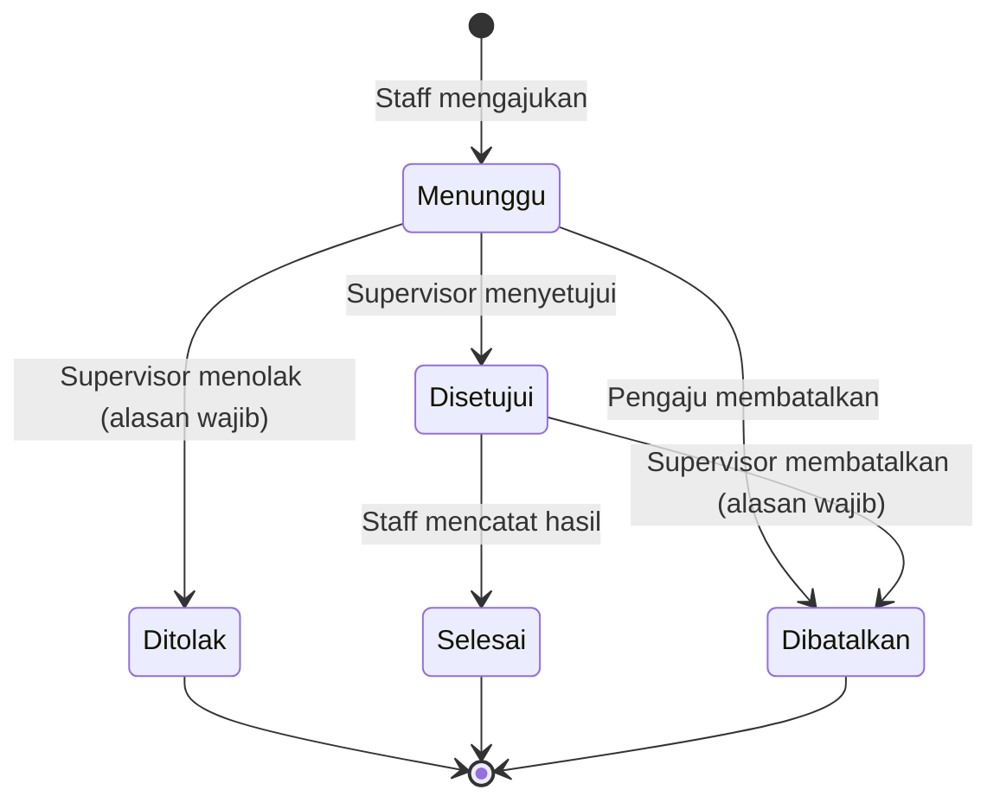
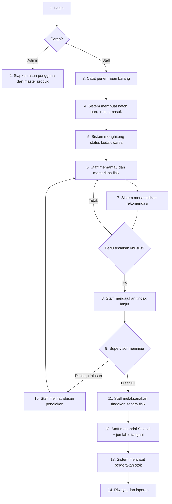
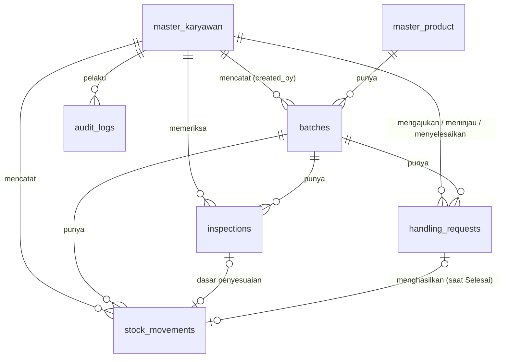
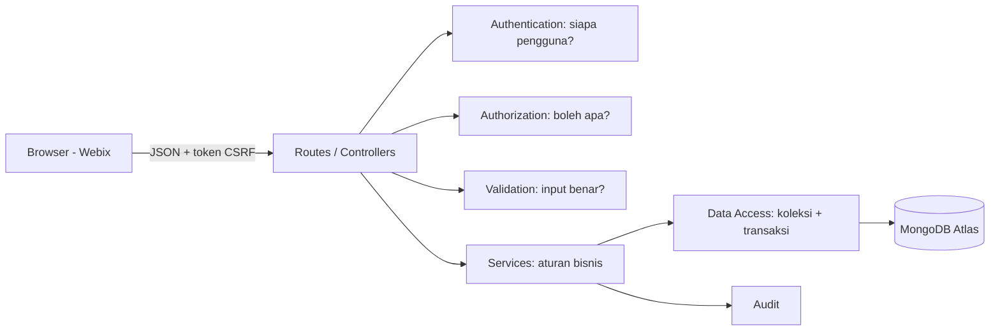

# SYSTEM DESIGN DOCUMENT
## Sistem Monitoring Stok dan Kedaluwarsa Produk pada Satu Outlet

| | |
|---|---|
| Versi | **2.1** |
| Tanggal | 14 November 2026 |
| Status | Rancangan acuan implementasi (menggantikan versi 1.x) |
| Dokumen terkait | `SRS_Smart_Expiry_Stock_Management_System.md` (versi 2.1) |

**Riwayat perubahan**

| Versi | Tanggal | Ringkasan |
|---|---|---|
| 1.x | 10–11 Nov 2026 | Rancangan multi-outlet (koleksi `locations`, peran per lokasi, batas kedaluwarsa dapat diubah Admin). |
| 2.0 | 12 Nov 2026 | Revisi menyeluruh: **satu outlet**, tiga peran dengan tugas baru, batas status tetap di kode, penyesuaian stok langsung oleh Staff dari hasil pemeriksaan, retur/pemusnahan lewat persetujuan Supervisor, koleksi disederhanakan, seluruh dokumen dalam bahasa Indonesia. Rincian di bagian 17. |
| 2.1 | 14 Nov 2026 | Penyesuaian dengan praktik ritel (keputusan pemilik 16–21, bagian 15): **stok minimum** dan daftar stok menipis; **barang terjual dicatat per produk** (otomatis FEFO) + impor rekap penjualan harian; **barang rusak dihitung per buah** (hanya yang rusak ditangani); **koreksi tanggal kedaluwarsa** lewat cek fisik + persetujuan Supervisor; **penyesuaian stok tampil di pemberitahuan** Supervisor/Admin; **login dikunci 15 menit setelah 5 kali salah password**; peran Admin ditegaskan sebagai admin sistem. Tambahan (keputusan 24–26): **barang rusak saat datang ditolak di penerimaan**, **satuan besar** (karton) saat barang datang, **jadwal cek fisik**. Keputusan 27–30: **ganti password sendiri** (wajib setelah dibuat/direset Admin), **keluar otomatis setelah 30 menit tidak aktif**, **tanggal penjualan** (mundur ≤ 7 hari), **pengajuan tidak bertumpuk**. |

**Cara membaca dokumen ini.** Bagian 1–7 menjelaskan *apa* yang dibangun dan *aturannya*. Bagian 8–12 menjelaskan *cara* membangunnya. Bagian 13–15 berisi pengujian, risiko, dan keputusan pemilik proyek. Bagian 16 mencatat perbedaan dengan aplikasi yang sudah dibangun sebelumnya.

**Padanan istilah (16 Nov 2026).** Agar mudah dipahami staf toko, tampilan layar, pesan, laporan Excel, dan riwayat aktivitas memakai bahasa sehari-hari yang baku. Dokumen ini, kode, dan database tetap memakai istilah teknis. Maknanya sama; hanya nama yang tampil di layar yang berbeda.

| Istilah di dokumen / kode | Tampil di layar |
|---|---|
| Batch (`batch_number`, koleksi `batches`) | **Kiriman** (menu **Stok Barang**) |
| Normal | **Aman** |
| Monitoring | **Dipantau** |
| Near Expired | **Hampir Kedaluwarsa** |
| Critical | **Kritis** |
| Expired | **Kedaluwarsa** |
| Retur (`return`) | **Pengembalian** (ke pemasok) |
| Pemusnahan (`disposal`) | **Pemusnahan** (tetap) |
| Penyesuaian stok (`adjustment_*`) | **Stok disamakan** |
| SKU | **Kode produk** |
| Rekomendasi | **Saran** (menu **Saran Tindakan**) |
| Import | **Impor** |

---

# 1. GAMBARAN UMUM APLIKASI

Aplikasi web untuk membantu **satu outlet** retail mencatat stok produk **per batch**, memantau tanggal kedaluwarsa tiap batch, mencatat pemeriksaan fisik, memberi **rekomendasi berbasis aturan sederhana**, dan mencatat **pengajuan serta persetujuan tindak lanjut** sampai selesai, lengkap dengan riwayat dan laporan.

Contoh sehari-hari: susu UHT yang sama bisa datang hari Senin (kedaluwarsa bulan depan) dan Kamis (kedaluwarsa tiga bulan lagi). Kedua kedatangan itu dicatat sebagai **dua batch** terpisah supaya masing-masing dapat dipantau.

Aplikasi ini **bukan sistem kasir (POS)**. Aplikasi tidak memproses penjualan ke pelanggan dan tidak terhubung dengan POS atau sistem perusahaan lain. Stok hanya berubah melalui pencatatan oleh pengguna.

---

# 2. TUJUAN DAN RUANG LINGKUP

## 2.1 Tujuan

1. Menyimpan data master produk di satu tempat.
2. Mencatat stok masuk per batch beserta tanggal masuk dan tanggal kedaluwarsa.
3. Mencatat stok keluar dan penyesuaian stok sehingga setiap perubahan stok dapat ditelusuri.
4. Menghitung status kedaluwarsa setiap batch secara otomatis.
5. Mencatat hasil pemeriksaan fisik (jumlah dan kondisi barang).
6. Memberi rekomendasi tindakan yang dapat dijelaskan alasannya.
7. Mengatur pengajuan tindak lanjut oleh Staff dan persetujuan oleh Supervisor.
8. Menyediakan laporan, riwayat aktivitas, dan ekspor Excel.

## 2.2 Ruang lingkup (termasuk)

| Modul | Isi |
|---|---|
| Autentikasi dan pengguna | Login, logout, tiga peran, pengelolaan akun oleh Admin. |
| Dashboard | Ringkasan stok, status kedaluwarsa, pengajuan, stok menipis, barang rusak, penyesuaian stok, dan usulan koreksi tanggal. |
| Master Produk | Tambah, ubah, nonaktifkan, cari, impor CSV, stok minimum (titik pesan ulang). |
| Manajemen Stok | Stok masuk (membuat batch), barang terjual per produk (batch dipilih otomatis FEFO), penyesuaian stok dari hasil pemeriksaan, impor CSV stok awal dan rekap penjualan harian. |
| Monitoring Kedaluwarsa | Status per batch, daftar peringatan, urutan FEFO. |
| Pemeriksaan dan Tindak Lanjut | Pemeriksaan fisik (jumlah, barang rusak per buah, pencocokan tanggal di kemasan), koreksi tanggal dengan persetujuan, rekomendasi, pengajuan, persetujuan, penyelesaian. |
| Laporan dan Riwayat | Sembilan laporan, riwayat aktivitas, ekspor `.xlsx`. |

---

# 3. BATASAN SISTEM

| Tidak termasuk | Keterangan |
|---|---|
| Multi-outlet dan multi-gudang | Aplikasi hanya untuk satu outlet. Tidak ada data lokasi. |
| Transfer stok | Tidak ada transfer antar-outlet atau antar-gudang. |
| POS dan integrasi sistem lain | Tidak ada transaksi kasir, pembayaran, atau sinkronisasi penjualan. |
| Analisis pola pembelian dan bundling | Tidak ada. |
| AI atau Machine Learning | Rekomendasi murni aturan tetap (*rule-based*). |
| Perubahan stok otomatis | Stok tidak pernah berubah tanpa catatan pergerakan stok. |
| Pembelian dan supplier | Tidak ada purchase order atau data supplier. |
| Notifikasi eksternal | Tidak ada WhatsApp, SMS, atau email. Pemberitahuan hanya di dalam aplikasi. |
| Eksekusi tindakan fisik | Aplikasi hanya **mencatat**; retur dan pemusnahan dilakukan di luar aplikasi. |
| Produk tanpa tanggal kedaluwarsa | Barang seperti sabun atau alat tulis tidak dicatat di aplikasi ini. Aplikasi khusus barang yang punya tanggal kedaluwarsa. |
| Diskon dan promosi | Tidak ada pengajuan atau rekomendasi diskon. Harga jual disimpan di master produk sebagai informasi, tetapi aplikasi tidak mengubah harga. |

**Asumsi:**

1. Jumlah stok di aplikasi adalah **stok tercatat**, hasil pencatatan pengguna, bukan data real-time dari kasir.
2. Rekomendasi hanya saran. Keputusan tetap di tangan manusia dan mengikuti SOP outlet.
3. Zona waktu bisnis adalah **Asia/Jakarta (WIB)**. Waktu disimpan dalam UTC dan ditampilkan dalam WIB.

---

# 4. ROLE DAN HAK AKSES

## 4.1 Tiga peran

| Peran (kode) | Fokus | Ringkasan tugas |
|---|---|---|
| **Admin** (`admin`) | Administrasi **sistem** (bukan admin gudang) | Mengelola akun pengguna dan master produk, melihat seluruh data, laporan, dan riwayat aktivitas, serta **memantau penyesuaian stok** lewat pemberitahuan. **Tidak** menjalankan operasional stok harian dan **tidak menyetujui** pengajuan. |
| **Supervisor** (`supervisor`) | Pengawasan | Hak atas master produk sama dengan Admin. Fokus pada pengawasan: menyetujui/menolak pengajuan, memeriksa fisik (cek silang), memantau aktivitas Staff, dan menindaklanjuti pengajuan yang belum selesai. Tidak bersinggungan langsung dengan data gudang (tidak mencatat atau mengoreksi data batch dan stok). |
| **Staff** (`staff`) | Operasional | Mencatat stok masuk dan keluar, memeriksa fisik, menyesuaikan stok dari hasil pemeriksaan, mengajukan retur/pemusnahan, lalu mencatat penyelesaiannya. |

**Prinsip pemisahan tugas.** Yang **mencatat** transaksi stok (Staff) dipisahkan dari yang **menyetujui** (Supervisor). Karena itu Supervisor tidak mencatat stok masuk/keluar, dan pengajuan hanya dibuat oleh Staff. Dengan begitu Supervisor tidak pernah menyetujui pengajuannya sendiri tanpa perlu aturan tambahan. Server tetap menolak bila `submitted_by` sama dengan peninjau, sebagai pengaman.

**Mengapa Admin adalah admin sistem, bukan admin gudang (keputusan 14 Nov 2026).** Urusan gudang sudah dipegang Staff. Admin yang bisa membuat akun tidak boleh ikut menyetujui pengeluaran barang: bila boleh, satu orang dapat membuat akun palsu lalu menyetujui pengajuannya sendiri. Ini prinsip *segregation of duties* (pemisahan tugas). Karena itu Admin hanya mengelola sistem dan **memantau**; persetujuan tetap di tangan Supervisor.

**Aturan akun:**

- Satu akun memiliki tepat satu peran. Peran dan izinnya ditetapkan di kode, tidak dapat diatur dari aplikasi.
- Akun tidak pernah dihapus, hanya dinonaktifkan. Akun nonaktif tidak bisa login.
- Admin tidak dapat menonaktifkan akunnya sendiri dan tidak dapat menurunkan peran Admin terakhir yang masih aktif (agar sistem tidak kehilangan Admin).

## 4.2 Matriks hak akses

Keterangan: **L** = lihat, **T** = tambah/catat, **U** = ubah, **S** = setujui/tolak, **N** = nonaktifkan/batalkan, **H** = hapus permanen, **–** = tidak boleh.

| Fitur | Staff | Supervisor | Admin |
|---|---|---|---|
| Dashboard | L | L | L |
| Pengguna (akun) | – | – | L T U N, atur ulang password |
| Master produk | L | L T U N, H* | L T U N, H* |
| Impor CSV master produk | – | T | T |
| Stok masuk (membuat batch) | T | L | L |
| Impor CSV stok awal | T | L | L |
| Barang terjual (per produk) dan impor rekap penjualan | T | L | L |
| Penyesuaian stok (dari hasil pemeriksaan) | T (langsung) | L + pemberitahuan | L + pemberitahuan |
| Monitoring kedaluwarsa | L | L | L |
| Pemeriksaan fisik | T | T | L |
| Koreksi tanggal kedaluwarsa | usulkan (lewat cek fisik) | usulkan; S (bukan usulan sendiri) | L |
| Rekomendasi | L | L | L |
| Pengajuan tindak lanjut | T (ajukan), N (milik sendiri, saat Menunggu), selesaikan | S, N (saat Disetujui) | L |
| Laporan dan ekspor Excel | – | L | L |
| Riwayat aktivitas (audit) | – | L | L |
| Pergerakan stok, pemeriksaan, riwayat pengajuan, audit log | tidak dapat diubah atau dihapus oleh siapa pun | | |

\* **H** hanya untuk produk yang **belum pernah** memiliki batch. Produk yang sudah punya riwayat hanya dapat dinonaktifkan.

Semua hak akses diperiksa di **server** pada setiap permintaan. Menyembunyikan tombol di tampilan hanya untuk kenyamanan, bukan pengaman.

---

# 5. MODUL DAN FITUR

## 5.1 Dashboard

Kartu ringkasan (semua peran melihat angka yang sama karena hanya ada satu outlet):

| Kartu | Cara menghitung |
|---|---|
| Total produk aktif | Jumlah produk dengan `is_active = true`. |
| Total stok tersedia | Jumlah stok yang **boleh dijual**: batch belum Expired, dikurangi barang rusak yang belum ditangani. |
| Stok menipis | Jumlah produk aktif yang stok minimumnya diisi (> 0) dan stok yang boleh dijual ≤ stok minimum. |
| Barang rusak | Jumlah barang rusak (dari cek fisik) yang belum diretur/dimusnahkan. |
| Batch Normal / Monitoring / Near Expired / Critical / Expired | Jumlah batch per status, **hanya batch dengan stok > 0**. Batch yang stoknya sudah 0 tidak dipantau lagi. |
| Pengajuan menunggu persetujuan | Jumlah pengajuan berstatus Menunggu. |

Tambahan sesuai peran:

- **Staff**: kartu "Pengajuan disetujui, belum diselesaikan" (milik semua Staff, karena penyelesaian boleh dilakukan Staff mana pun; lihat 7.8).
- **Supervisor**: kartu "Menunggu persetujuan" dapat diklik dan langsung membuka daftar yang perlu ditinjau; kartu "Koreksi tanggal" (usulan menunggu).
- **Supervisor dan Admin**: kartu "Stok disamakan" (jumlah penyesuaian stok 7 hari terakhir yang belum dicek ulang Supervisor).

Ikon lonceng (notifikasi di dalam aplikasi) dihitung saat dibuka, tidak disimpan:

- Supervisor: pengajuan berstatus Menunggu, usulan koreksi tanggal yang menunggu, dan penyesuaian stok 7 hari terakhir yang belum dicek ulang. Stok menipis **tidak** masuk lonceng (cukup di kartu dashboard dan laporan Stok menipis).
- Admin: penyesuaian stok 7 hari terakhir yang belum dicek ulang (pengawasan).
- Pemberitahuan penyesuaian hilang sendiri setelah seorang **Supervisor mencatat cek fisik pada kiriman yang sama sesudah penyesuaian itu** (itulah pengawasannya). Cek fisik oleh Staff tidak menghilangkannya. Riwayatnya tetap ada di laporan Riwayat penyesuaian stok dan Riwayat Aktivitas.
- Staff: pengajuan yang Disetujui (belum selesai) dan pengajuan miliknya yang Ditolak dalam 7 hari terakhir.

## 5.2 Master Produk

| Field | Aturan |
|---|---|
| Kode produk / SKU | Wajib, unik, tidak dapat diubah setelah dibuat. Huruf, angka, `-` dan `_`, maksimal 30 karakter. |
| Nama produk | Wajib, maksimal 120 karakter. |
| Kategori | Wajib, maksimal 50 karakter (teks bebas). |
| Satuan | Wajib (contoh: pcs, kotak, botol), maksimal 20 karakter. |
| Harga jual | Wajib, bilangan bulat rupiah ≥ 0. Hanya informasi; tidak dipakai untuk transaksi atau diskon. |
| Satuan besar dan isinya | Opsional, keduanya diisi atau keduanya kosong: nama (misalnya karton, dus, ≤ 20 karakter) dan isi (2–10.000 satuan terkecil). Hanya dipakai saat barang datang. |
| Stok minimum | Opsional, bilangan bulat ≥ 0 (default 0 = tidak dipantau). Titik pesan ulang: bila stok yang boleh dijual ≤ angka ini, produk masuk daftar **stok menipis**. |
| Deskripsi | Opsional, maksimal 500 karakter. |
| Status | Aktif / Nonaktif. |

Aturan:

- Produk nonaktif tidak dapat dipilih untuk stok masuk baru, tetapi batch lamanya tetap dipantau dan tetap dapat dicatat stok keluar atau diajukan tindak lanjut sampai stoknya habis.
- Produk yang sudah pernah memiliki batch **tidak boleh dihapus permanen**, hanya dinonaktifkan.
- Pencarian berdasarkan SKU atau nama; filter kategori dan status.

## 5.3 Manajemen Stok

Ada tiga jenis pergerakan stok. **Stok sebuah batch hanya berubah lewat pergerakan ini.**

| Jenis | Kode | Arah | Siapa | Persetujuan |
|---|---|---|---|---|
| Stok masuk | `stock_in` | + | Staff | Tidak perlu |
| Stok keluar | `stock_out` | − | Staff (barang **terjual**, dicatat per produk) atau sistem saat pengajuan retur/pemusnahan diselesaikan | Stok keluar biasa: tidak perlu. Retur/pemusnahan: lewat pengajuan. |
| Penyesuaian naik / turun | `adjustment_in` / `adjustment_out` | + / − | Staff, dari hasil pemeriksaan fisik yang memiliki selisih | Tidak perlu |

### A. Stok masuk

Form berisi produk (aktif), jumlah datang, jumlah ditolak + alasannya, tanggal masuk, tanggal kedaluwarsa, dan catatan opsional.

- **Satuan besar.** Bila produk punya satuan besar (misalnya karton isi 24), jumlah datang boleh diisi "3 karton + 5 kotak". Sistem mengubahnya ke satuan terkecil (77 kotak) dan menampilkannya di layar konfirmasi. **Stok selalu disimpan dalam satuan terkecil**, karena penjualan, kedaluwarsa, barang rusak, dan cek fisik dihitung per buah. Rincian karton disimpan di batch (`pack`) sebagai informasi.
- **Barang rusak saat datang ditolak di penerimaan** (praktik ritel: dikembalikan ke pengirim saat itu juga dan ditulis di surat jalan). Barang itu **tidak pernah menjadi stok toko**, jadi tidak perlu retur/pemusnahan atau persetujuan. Jumlah masuk stok = jumlah datang − jumlah ditolak. Jumlah dan alasan penolakan (wajib bila ada yang ditolak) disimpan di batch dan audit log. Bila **semua ditolak**, tidak ada batch yang dibuat dan stok tidak berubah, tetapi kejadiannya dicatat di Riwayat Aktivitas (`receipt_rejected`). Barang yang rusak **setelah** diterima tetap lewat cek fisik → retur/pemusnahan (5.5).

Saat disimpan (dan ada barang yang diterima), sistem dalam **satu transaksi**:

1. Membuat **batch baru** dengan **nomor batch internal** yang dibuat sistem: `BT-YYMMDD-NNN` (tanggal masuk + nomor urut harian, misalnya `BT-261112-003`). Pengguna tidak mengetik nomor batch, sehingga tidak bisa ada salah ketik atau nomor kembar.
2. Mencatat pergerakan `stock_in` sebesar jumlah tersebut, beserta pencatatnya.

**Setiap penerimaan barang selalu menghasilkan batch tersendiri**, walaupun produk dan tanggal kedaluwarsanya sama dengan batch lain.

Validasi: jumlah bilangan bulat 1–100.000; tanggal masuk tidak boleh di masa depan; tanggal kedaluwarsa > tanggal masuk dan **> hari ini** (barang yang sudah kedaluwarsa, termasuk yang kedaluwarsa hari ini, tidak dicatat sebagai penerimaan baru).

**Konfirmasi sebelum simpan.** Data batch tidak dapat diubah langsung setelah disimpan; tanggal kedaluwarsa hanya dapat dikoreksi lewat usulan dari cek fisik yang disetujui Supervisor (5.3 E). Karena itu form menampilkan ringkasan sebelum disimpan, misalnya "Susu UHT, 48 kotak, kedaluwarsa 20 Des 2026 (sisa 38 hari, Normal). Benar?", dan Staff harus menekan **Konfirmasi**.

### B. Barang terjual (stok keluar biasa)

Stok keluar biasa berarti **barang terjual**, sehingga **tanpa alasan**. Barang yang keluar karena alasan lain (rusak, kedaluwarsa, dikembalikan) tidak dicatat di sini, tetapi lewat pengajuan retur atau pemusnahan.

**Dicatat per produk, bukan per batch (keputusan 14 Nov 2026).** Aplikasi ini bukan kasir, jadi Staff mencatat **rekap penjualan** (misalnya rekap kasir harian): pilih produk, isi total terjual, catatan opsional. Sistem lalu:

1. Mengambil batch produk itu yang **boleh dijual** dan sudah datang pada **tanggal penjualan**, urut **FEFO** (kedaluwarsa terdekat lebih dulu). Tanggal penjualan default hari ini dan boleh mundur paling lama **7 hari** (rekap kasir kemarin biasanya dicatat besok paginya); tidak boleh tanggal yang akan datang. Tanggal ini menjadi `movement_date`, sehingga laporan per tanggal tetap tepat.
2. Mengurangi stok mulai dari batch pertama; bila tidak cukup, sisanya diambil dari batch berikutnya. Contoh: terjual 35, batch A sisa 30 dan batch B sisa 40 → A berkurang 30, B berkurang 5.
3. Mencatat satu `stock_out` per batch yang terpakai, semuanya dalam **satu transaksi**. Form menampilkan rencana pengurangan sebelum disimpan, dan pesan sesudah simpan menyebut batch mana saja yang dikurangi.

Aturan:

- Batch **Expired** dan **barang rusak yang belum ditangani** tidak pernah ikut terhitung (barang itu hanya keluar lewat pengajuan, 5.5 C).
- Jumlah tidak boleh melebihi total stok yang boleh dijual; pesannya menyebut sisa yang bisa dijual.
- Staff tidak perlu tahu nomor batch. Alasan memilih FEFO otomatis: sesuai praktik ritel (barang yang paling cepat kedaluwarsa diletakkan di depan rak dan terjual lebih dulu). Bila kenyataannya berbeda, selisihnya terlihat saat cek fisik dan diperbaiki lewat penyesuaian (5.3 C).
- **Impor rekap penjualan harian** (CSV `sku,quantity`, 9.3b) memakai aturan yang sama untuk banyak produk sekaligus.
- API tetap menerima `batch_id` untuk kasus khusus satu batch tertentu (dengan aturan yang sama: tidak Expired, tidak mengambil barang rusak).

### C. Penyesuaian stok

Penyesuaian dipakai bila **stok fisik berbeda dengan stok sistem**. Ini urusan pencatatan gudang sehari-hari, sehingga **Staff mencatatnya langsung tanpa persetujuan Supervisor**. Supaya tetap terkendali, penyesuaian **selalu berasal dari hasil pemeriksaan fisik**, bukan angka yang diketik bebas:

1. Staff mencatat pemeriksaan fisik dan hasilnya menunjukkan selisih (misalnya sistem 50, fisik 48).
2. Halaman hasil pemeriksaan menampilkan tombol **"Sesuaikan stok"** (hanya untuk Staff).
3. Setelah dikonfirmasi, sistem mencatat `adjustment_out` atau `adjustment_in` sebesar selisihnya (di contoh: turun 2), sehingga stok sistem sama dengan stok fisik.

Aturan:

- Arah dan jumlah **diisi otomatis dari selisih** dan tidak dapat diubah. Catatan pemeriksaan menjadi alasan penyesuaian.
- **Satu pemeriksaan hanya dapat menghasilkan satu penyesuaian** (indeks unik `source.inspection_id`), sehingga tombol yang ditekan dua kali tidak menggandakan penyesuaian.
- Penyesuaian hanya dapat dicatat bila **belum ada pergerakan stok lain** pada batch itu sejak pemeriksaan. Bila sudah ada, sistem menolak dengan pesan "Stok berubah sejak pemeriksaan; lakukan pemeriksaan ulang".
- Penyesuaian boleh merujuk pemeriksaan yang dicatat Staff maupun Supervisor.
- Supervisor dan Admin dapat memantau semua penyesuaian lewat laporan 6 (Riwayat penyesuaian stok) dan Riwayat Aktivitas. Selain itu, **setiap penyesuaian 7 hari terakhir muncul di pemberitahuan (lonceng) Supervisor dan Admin** dan di kartu dashboard "Stok disamakan" sampai Supervisor mengecek fisik kiriman itu. Jadi penyesuaian tetap tanpa persetujuan (keputusan 5), tetapi **selalu terlihat** oleh pengawas, sehingga tidak bisa dipakai diam-diam untuk menutupi barang hilang.

### D. Aturan umum pergerakan stok

- Pergerakan stok yang sudah tersimpan **tidak dapat diubah atau dihapus**. Kesalahan jumlah dikoreksi dengan pergerakan baru: lakukan pemeriksaan fisik, lalu penyesuaian (5.3 C).
- Setiap pergerakan menyimpan `quantity_before` dan `quantity_after` yang dihitung server.
- Stok batch tidak pernah negatif (penjelasan teknis di 8.9).

### E. Koreksi tanggal kedaluwarsa (lewat cek fisik + persetujuan Supervisor)

Salah ketik tanggal adalah *human error* yang tetap bisa terjadi walaupun ada layar konfirmasi. Yang paling berbahaya adalah tanggal yang tercatat **lebih lambat** dari tanggal di kemasan (misalnya tertulis 2027-11-20, padahal di kemasan 2026-11-20): peringatan kedaluwarsa tidak pernah muncul dan barang kedaluwarsa bisa terjual. Karena itu:

1. Setiap **cek fisik** memuat pertanyaan **"Tanggal kedaluwarsa di kemasan: Sesuai / Berbeda"**. Bila berbeda, pemeriksa mengisi tanggal yang tertulis di kemasan dan catatan wajib.
2. Tanggal itu menjadi **usulan koreksi** (status Menunggu). Tanggal batch **belum berubah**.
3. **Supervisor** (bukan pemeriksa itu sendiri) menyetujui atau menolak (alasan tolak wajib). Admin tidak memutuskan.
4. Bila disetujui, tanggal batch diganti dan tanggal lama disimpan di `batches.expiry_history` (siapa mengusulkan, siapa menyetujui, kapan). Status kedaluwarsa langsung dihitung ulang dari tanggal baru.

Aturan: satu usulan menunggu per batch; tanggal usulan harus berbeda dari yang tercatat; persetujuan ditolak bila tanggal batch sudah berubah sejak cek fisik; semua langkah tercatat di Riwayat Aktivitas. Produk, tanggal masuk, dan jumlah awal batch tetap tidak dapat diubah.

## 5.4 Monitoring Kedaluwarsa

Status dihitung **per batch**, bukan per produk.

**Rumus:** `sisa_hari = tanggal_kedaluwarsa − tanggal_hari_ini` (keduanya tanggal kalender WIB, hasil dalam hari utuh).

| Status | Kode | Sisa hari | Warna |
|---|---|---|---|
| Normal | `normal` | > 30 | Hijau |
| Monitoring | `monitoring` | 15 sampai 30 | Biru |
| Near Expired | `near_expired` | 8 sampai 14 | Kuning/oranye |
| Critical | `critical` | 1 sampai 7 | Merah |
| Expired | `expired` | ≤ 0 (hari ini atau sudah lewat) | Merah tua |

Batas-batas ini tidak tumpang tindih dan menutup semua kemungkinan bilangan bulat.

**Produk yang tanggal kedaluwarsanya tepat hari ini** (sisa 0 hari) berstatus **Expired** sejak pukul 00.00 WIB hari itu dan **tidak boleh dijual lagi**. Contoh: batch dengan tanggal kedaluwarsa 20 Nov masih Critical pada 19 Nov (sisa 1 hari) dan menjadi Expired mulai 20 Nov. Tampilan memberi label **"Kedaluwarsa hari ini"** untuk sisa 0 hari dan **"Lewat N hari"** untuk sisa negatif.

*Catatan:* prompt revisi menulis Critical "0–7". Pemilik proyek kemudian memutuskan (12 Nov 2026) bahwa barang tidak boleh dijual pada tanggal kedaluwarsanya, sehingga sisa 0 hari dimasukkan ke Expired dan Critical menjadi 1–7.

Aturan:

- Batas hari ditetapkan sebagai **konstanta di kode** (`app/common/constants.py`), tidak dapat diubah dari aplikasi.
- Status **tidak disimpan** di database karena berubah setiap hari; status dihitung setiap kali data dibaca.
- Batch yang stoknya 0 tidak ditampilkan di daftar peringatan dan tidak dihitung di dashboard. Datanya tetap ada untuk riwayat.
- Batch Expired tidak dihapus otomatis.
- Halaman Monitoring menampilkan batch Monitoring, Near Expired, Critical, dan Expired (stok > 0), urut dari sisa hari terkecil, dengan filter status dan produk.

## 5.5 Pemeriksaan dan Tindak Lanjut

### A. Pemeriksaan fisik

Dicatat oleh Staff atau Supervisor untuk satu batch:

| Field | Aturan |
|---|---|
| Stok sistem saat diperiksa | Diisi otomatis oleh server (snapshot). |
| Jumlah fisik | Wajib, bilangan bulat ≥ 0. Menghitung **semua** barang batch itu, termasuk yang rusak. |
| Kondisi produk | Wajib: `baik` atau `rusak`. |
| Kondisi kemasan | Wajib: `baik` atau `rusak`. |
| Jumlah rusak | Wajib bila salah satu kondisi `rusak`: 1 sampai jumlah fisik. Harus 0 bila keduanya `baik`. |
| Tanggal di kemasan | `Sesuai` (default) atau `Berbeda` + tanggal yang tertulis di kemasan (menjadi usulan koreksi, 5.3 E). |
| Catatan | Wajib bila ada selisih jumlah, ada barang rusak, atau tanggal di kemasan berbeda; selain itu opsional. Maksimal 500 karakter. |
| Waktu dan pemeriksa | Diisi otomatis oleh server. |

- Setiap pemeriksaan adalah **catatan baru**; riwayat lama tidak ditimpa.
- **Jadwal cek fisik** (keputusan 26): batch yang masih ada stoknya wajib dicek paling lambat **Critical tiap 1 hari, Near Expired tiap 3 hari, Monitoring dan Normal tiap 7 hari** (konstanta `CHECK_INTERVAL_DAYS`). Tanggal barang datang dihitung sebagai cek pertama karena barang diperiksa saat diterima. Batch Expired tidak dijadwalkan (harus ditarik dan diajukan). Batch yang sudah waktunya dicek muncul di tab **"Perlu dicek"** halaman Pantau Kedaluwarsa (paling mendesak di atas), kartu dashboard Staff "Perlu cek fisik", dan lonceng Staff. Jadwal dihitung saat dibaca, tidak disimpan. Ini sejalan dengan praktik *cycle count* ritel: barang berisiko diperiksa lebih sering.
- **Pemeriksaan tidak mengubah stok.** Bila ada selisih, aplikasi menampilkan selisihnya dan tombol "Sesuaikan stok" (hanya untuk Staff, lihat 5.3 C).
- **Barang rusak dihitung per buah (standar ritel, keputusan 14 Nov 2026).** Di toko, barang rusak dipisahkan satu per satu (misalnya ke keranjang "barang BS"/*bad stock*), bukan seluruh batch. Jadi bila dari 24 botol ada 2 yang penyok, hanya 2 botol itu yang wajib diretur/dimusnahkan; 22 lainnya tetap boleh dijual.
- **Jumlah rusak yang belum ditangani** = jumlah rusak pada pemeriksaan terakhir − jumlah yang sudah keluar lewat pengajuan "barang rusak" setelah pemeriksaan itu. **Stok yang boleh dijual** = stok − jumlah rusak (0 bila Expired). Keduanya dihitung saat dibaca, tidak disimpan.
- **Kondisi batch:** *layak* (sudah dicek, tidak ada yang rusak); *sebagian rusak*; *tidak layak* (semua sisa stok rusak, atau batch Expired); *belum diperiksa*. Pemeriksaan ulang yang menyatakan semua `baik` membuat batch layak kembali.

### B. Rekomendasi sistem (rule-based)

Rekomendasi dihitung setiap kali halaman dibuka dan **tidak disimpan**. Setiap batch dengan stok > 0 mendapat **tepat satu** rekomendasi, yaitu aturan pertama yang cocok dari atas ke bawah:

| Urutan | Kondisi | Rekomendasi | Alasan yang ditampilkan (contoh) |
|---|---|---|---|
| 1 | Expired | Tarik produk dari area penjualan dan ajukan retur atau pemusnahan sesuai prosedur. | "Sudah lewat tanggal kedaluwarsa 2 hari." |
| 2 | Ada barang rusak yang belum ditangani | Pisahkan **barang yang rusak saja** dan ajukan retur atau pemusnahan untuk barang itu; sisanya tetap boleh dijual. | "Cek fisik 10 Nov: kemasan rusak. Ada 2 botol yang rusak … Sisanya (22 botol) masih bagus dan tetap boleh dijual." |
| 3 | Critical | Prioritaskan penanganan: keluarkan batch ini lebih dulu (FEFO) dan pastikan kondisinya dengan pemeriksaan fisik. Bila tidak akan terjual sebelum kedaluwarsa, ajukan retur ke pemasok selagi masih layak. | "Sisa 3 hari. Pemeriksaan terakhir: layak. … ajukan retur ke pemasok selagi masih layak." |
| 4 | Near Expired | Prioritaskan penjualan batch ini berdasarkan FEFO. | "Sisa 10 hari." |
| 5 | Monitoring | Pantau dan prioritaskan penjualan berdasarkan FEFO. | "Sisa 20 hari; batch ini paling cepat kedaluwarsa untuk produk ini." |
| 6 | Normal | Tidak membutuhkan tindakan khusus. | "Sisa 45 hari." |

Aturan tambahan:

- **Tidak ada rekomendasi diskon.** Aturan 1 dan 2 selalu diperiksa lebih dulu, sehingga batch Expired atau tidak layak tidak pernah disarankan untuk dijual.
- Pada aturan 3, bila batch **belum pernah diperiksa**, alasan menambahkan: "Belum diperiksa; lakukan pemeriksaan fisik."
- Rekomendasi **tidak mengubah stok** dan **tidak menjalankan tindakan apa pun**. Rekomendasi hanya menampilkan tombol pintasan "Buat pengajuan" (untuk Staff) yang mengisi form secara otomatis.

### C. Pengajuan tindak lanjut

Pengajuan dipakai untuk **penanganan barang yang sudah kedaluwarsa, mendekati kedaluwarsa, atau rusak**, yaitu barang yang dikeluarkan bukan karena terjual. Penanganan ini **wajib disetujui Supervisor**.

**Jenis pengajuan (hanya dua):**

| Jenis | Kode | Syarat saat diajukan | Efek pada stok saat Selesai |
|---|---|---|---|
| Retur | `return` | Batch memenuhi syarat (lihat di bawah). | `stock_out` sebesar jumlah yang benar-benar diretur. |
| Pemusnahan | `disposal` | Batch memenuhi syarat (lihat di bawah). | `stock_out` sebesar jumlah yang benar-benar dimusnahkan. |

**Dasar pengajuan (`basis`) dan jumlah** (direvisi 14 Nov 2026, standar ritel):

| Dasar | Kondisi batch (stok > 0) | Jenis yang boleh | Jumlah |
|---|---|---|---|
| `expired` (Barang Expired) | Batch **Expired** | Retur **atau** Pemusnahan | **Wajib seluruh stok batch** (semua unit kedaluwarsa pada tanggal yang sama) |
| `damaged` (Barang rusak) | Ada barang rusak yang belum ditangani (dari cek fisik) | Retur **atau** Pemusnahan | **Wajib semua barang rusak itu sekaligus** (jumlahnya tetap, dari cek fisik) |
| `near_expiry` (Mendekati kedaluwarsa) | Batch **Near Expired** atau **Critical**, barang yang masih bagus | **Hanya Retur** (barang layak tidak dimusnahkan) | Boleh sebagian (1 sampai jumlah barang yang masih bagus) |
| — | Normal atau Monitoring tanpa barang rusak | **Tidak boleh diajukan** | — |

Sistem menghitung pilihan dasar ini (`request_options`) dan form hanya menawarkan pilihan yang sah; dropdown produk di form Ajukan pun hanya memuat produk yang punya pilihan sah, dengan keterangan alasannya (kedaluwarsa, ada yang rusak, hampir kedaluwarsa). Bila batch punya lebih dari satu pilihan (misalnya Critical dengan 3 barang rusak), Staff memilih barang mana yang diajukan. Data batch juga memuat pengajuan yang masih terbuka (`open_requests`), dan pilihan yang terhalang olehnya diberi tanda `blocked_by` (aturan yang sama dengan pemeriksaan saat mengajukan). Dengan begitu tampilan menulis "Sudah diajukan (PG-..., Disetujui)" alih-alih tombol Ajukan, sehingga Staff tidak mengisi form yang pasti ditolak.

**Urutan penanganan ala ritel: jual → retur → musnahkan.** Pemusnahan menimbulkan kerugian bagi toko (di ritel disebut *shrink*), sehingga menjadi pilihan terakhir. Barang yang masih layak didahulukan untuk dijual (FEFO); bila tidak akan terjual, diretur ke pemasok selagi masih layak (kerugian dapat beralih ke pemasok sesuai perjanjian dagang); pemusnahan hanya untuk barang Expired atau rusak yang tidak dapat diretur.

Alasan perbedaan: batch Expired ditangani utuh karena semua unitnya kedaluwarsa pada tanggal yang sama; barang rusak ditangani per buah karena kerusakan biasanya terjadi pada unit tertentu (penyok, sobek) dan membuang barang yang masih bagus menambah kerugian (*shrink*). Saat pengajuan barang rusak diselesaikan, jumlah rusak berkurang otomatis dan batch kembali layak bila semua barang rusak sudah keluar.

Ketentuan umum: alasan wajib (maksimal 500 karakter); **hanya satu pengajuan terbuka** (Menunggu atau Disetujui) per batch untuk **dasar** yang sama, dan pengajuan **Barang Expired** (seluruh stok) **ditolak selama masih ada pengajuan lain yang terbuka** untuk batch itu (misalnya pengajuan barang rusak), supaya tidak ada barang yang diajukan dua kali. Pengajuan lama diselesaikan atau dibatalkan dulu. Pengajuan **tidak mengunci stok**: selama menunggu, batch yang masih layak tetap boleh dijual; saat Selesai, jumlah yang ditangani tidak boleh melebihi stok saat itu, dan retur barang yang masih bagus tidak boleh mengambil jatah barang rusak yang belum ditangani.

**Status (lima):**



- Keputusan hanya dapat diambil **sekali**. Status akhir (Ditolak, Selesai, Dibatalkan) tidak dapat diubah lagi. Bila perlu, Staff membuat pengajuan baru.
- Setiap langkah dicatat di riwayat pengajuan (aksi, pelaku, peran, waktu, catatan).
- **Penyelesaian** dilakukan oleh Staff mana pun (lihat 7.8). Staff mengisi jumlah yang benar-benar ditangani (1 sampai jumlah yang disetujui, dan tidak melebihi stok batch saat itu) dan **keterangan bukti yang selalu wajib** (minimal 10 karakter), setara berita acara sederhana: untuk **retur**, nama pemasok dan nomor dokumen/surat jalan retur; untuk **pemusnahan**, cara pemusnahan dan saksi. Bila jumlahnya lebih kecil dari yang disetujui, alasannya ditulis di keterangan yang sama. Data pemasok tidak dikelola aplikasi (di luar ruang lingkup), jadi dicatat sebagai teks.

### D. Lima proses yang dibedakan

| # | Proses | Pelaku | Yang tercatat | Mengubah stok? |
|---|---|---|---|---|
| 1 | **Rekomendasi sistem** | Sistem | Tidak disimpan (dihitung saat dibuka) | Tidak |
| 2 | **Pengajuan tindakan** | Staff | `handling_requests` status Menunggu | Tidak |
| 3 | **Persetujuan** | Supervisor | Status Disetujui/Ditolak + peninjau + waktu + catatan | Tidak |
| 4 | **Pelaksanaan fisik** | Staff, **di luar aplikasi** | Tidak dicatat terpisah | — |
| 5 | **Pencatatan hasil** | Staff mencatat; sistem membuat pergerakan stok | Status Selesai + jumlah ditangani + `stock_movement_id` | Ya, bila jenisnya memengaruhi stok |

## 5.6 Laporan dan Riwayat

Halaman **Laporan** (Supervisor dan Admin). Setiap laporan memiliki filter, menampilkan tanggal pembuatan dan filter yang dipakai, dan dapat diekspor ke **Excel (`.xlsx`)**.

| # | Laporan | Sumber data | Filter |
|---|---|---|---|
| 1 | Stok produk | Stok yang boleh dijual per produk, barang rusak, barang Expired, stok minimum + tanda menipis, kedaluwarsa terdekat | Kategori, status produk |
| 2 | Stok per batch | `batches` + status dihitung | Produk, status kedaluwarsa, stok > 0 |
| 3 | Produk mendekati kedaluwarsa | Batch Near Expired dan Critical, stok > 0 | Status, produk |
| 4 | Produk kedaluwarsa | Batch Expired, stok > 0 | Produk |
| 5 | Riwayat stok masuk dan keluar | `stock_movements` jenis `stock_in`, `stock_out` | Rentang tanggal, produk, jenis |
| 6 | Riwayat penyesuaian stok | `stock_movements` jenis `adjustment_in`, `adjustment_out` | Rentang tanggal, produk |
| 7 | Riwayat pemeriksaan | `inspections` | Rentang tanggal, produk, kelayakan |
| 8 | Riwayat pengajuan dan tindak lanjut | `handling_requests` | Rentang tanggal, jenis, status |
| 9 | Stok menipis | Produk aktif dengan stok minimum > 0 dan stok yang boleh dijual ≤ stok minimum, beserta kekurangannya | Kategori |

Halaman **Riwayat Aktivitas** (Supervisor dan Admin) menampilkan `audit_logs`: siapa melakukan apa dan kapan, dengan filter tanggal, pengguna, dan jenis aksi. Halaman ini hanya bisa dibaca.

Aturan konsistensi:

- Semua angka laporan dibaca langsung dari koleksi operasional, bukan dari tabel ringkasan terpisah.
- Laporan 1 dan 2 memakai `current_quantity`, yang selalu sama dengan jumlah seluruh pergerakan batch (8.9). Konsistensi ini dapat diperiksa dengan uji rekonsiliasi (13.3).
- Ekspor berisi **semua baris yang cocok dengan filter** (bukan hanya satu halaman), maksimal 20.000 baris. Bila lebih, ekspor ditolak dengan pesan agar filter dipersempit. Data tidak pernah dipotong diam-diam.
- Setiap ekspor dicatat di audit log.

---

# 6. ALUR BISNIS UTAMA

## 6.1 Alur keseluruhan



## 6.2 Penjelasan langkah

| # | Langkah | Pelaku | Hasil di sistem |
|---|---|---|---|
| 1 | Login sesuai peran | Semua | Sesi dibuat; menu sesuai peran. |
| 2 | Menyiapkan akun dan master produk | Admin (produk juga Supervisor) | `master_karyawan`, `master_product` + audit log. |
| 3 | Mencatat penerimaan barang | Staff | Form stok masuk atau impor CSV stok awal. |
| 4 | Membuat batch baru | Sistem | `batches` baru + `stock_movements` `stock_in` dalam satu transaksi. |
| 5 | Memperbarui stok dan menghitung status | Sistem | `current_quantity` = jumlah masuk; status dihitung saat dibaca. |
| 6 | Monitoring dan pemeriksaan fisik | Staff (Supervisor untuk cek silang) | `inspections` baru. |
| 7 | Menampilkan rekomendasi | Sistem | Dihitung dari status + pemeriksaan terakhir; tidak disimpan. |
| 8 | Mengajukan tindak lanjut | Staff | `handling_requests` status Menunggu. |
| 9 | Menyetujui atau menolak | Supervisor | Status Disetujui/Ditolak; peninjau dan waktu dicatat. |
| 10 | Bila ditolak | Supervisor mengisi alasan; Staff melihatnya | Alasan wajib; tampil di detail pengajuan dan notifikasi Staff. |
| 11 | Melaksanakan tindakan fisik | Staff (di luar aplikasi) | — |
| 12 | Menandai Selesai | Staff | Status Selesai, jumlah ditangani, catatan. |
| 13 | Mencatat pergerakan stok | Sistem (otomatis, dalam transaksi yang sama dengan langkah 12) | `stock_movements` dengan `source.handling_request_id`. |
| 14 | Menyimpan riwayat dan laporan | Sistem | Audit log, riwayat pengajuan, laporan. |

Untuk **stok keluar biasa** (misalnya barang terjual), Staff mencatat langsung di form stok keluar tanpa pengajuan (5.3 B).

---

# 7. ATURAN BISNIS UNTUK KASUS PENTING

| # | Kasus | Aturan bisnis | Solusi sistem |
|---|---|---|---|
| 1 | Satu produk punya beberapa batch dengan tanggal kedaluwarsa berbeda | Setiap batch dipantau sendiri; jumlah antarbatch tidak digabung saat menentukan status. | Status dihitung per batch. Daftar batch per produk diurutkan menurut tanggal kedaluwarsa (FEFO). Laporan stok per produk hanya menjumlahkan, tetapi tetap menampilkan kedaluwarsa terdekat. |
| 2 | Menghitung stok tersisa per batch | Stok batch = jumlah seluruh pergerakan batch itu (+ masuk/penyesuaian naik, − keluar/penyesuaian turun). | `current_quantity` disimpan di batch untuk pengecekan cepat, tetapi **hanya** diubah di dalam transaksi yang sama dengan pencatatan pergerakan. Nilainya selalu dapat dihitung ulang dari `stock_movements` (8.9). |
| 3 | Stok fisik berbeda dengan stok sistem | Pemeriksaan tidak mengubah stok. Selisih diperbaiki oleh Staff lewat penyesuaian langsung yang **wajib berasal dari pemeriksaan**, tanpa persetujuan Supervisor. | Hasil pemeriksaan menampilkan selisih dan tombol "Sesuaikan stok". Penyesuaian menyimpan `source.inspection_id` sebagai bukti, hanya satu per pemeriksaan, dan hanya berlaku selama stok batch belum berubah sejak pemeriksaan itu. Supervisor memantaunya lewat laporan 6. |
| 4 | Staff mencatat stok keluar melebihi stok batch | Ditolak. | Server memakai pembaruan bersyarat (`current_quantity >= jumlah`). Bila gagal, transaksi dibatalkan dan muncul pesan "Jumlah melebihi stok batch (tersisa N)". Hal yang sama berlaku saat penyelesaian retur/pemusnahan dan penyesuaian turun. |
| 5 | Produk sudah kedaluwarsa tetapi stok masih ada | Batch tetap tercatat dan tampil sebagai Expired sampai stoknya 0. Tidak boleh dicatat sebagai stok keluar biasa (tidak boleh dijual), termasuk pada tanggal kedaluwarsanya sendiri. | Rekomendasi: tarik dan ajukan retur/pemusnahan. Stok baru berkurang saat pengajuan itu diselesaikan. Dashboard dan laporan 4 terus menampilkannya. |
| 6 | Kemasan atau produk rusak | Hanya barang yang rusak yang dipisahkan (standar ritel). | Cek fisik mencatat **jumlah rusak**. Barang rusak tidak bisa ikut terjual (stok yang boleh dijual = stok − rusak); rekomendasi "Pisahkan barang rusak"; pengajuan untuk **semua barang rusak itu** (retur/pemusnahan). Sisanya tetap dijual. Bila semua sisa stok rusak, batch tidak layak. Pemeriksaan ulang yang menyatakan semua `baik` membuat batch layak kembali. |
| 7 | Pengajuan ditolak Supervisor | Alasan penolakan wajib diisi. Status Ditolak bersifat final. | Staff melihat alasan di detail pengajuan dan notifikasi (7 hari). Staff boleh membuat pengajuan baru untuk batch dan jenis yang sama karena pengajuan lama sudah tertutup. |
| 8 | Staff belum menyelesaikan pengajuan yang sudah disetujui | Pengajuan tetap Disetujui; tidak ada batas waktu otomatis. Penyelesaian boleh dilakukan Staff mana pun, supaya tidak macet bila pengaju sedang tidak bertugas. | Dashboard dan notifikasi Staff menampilkan "Disetujui, belum diselesaikan" beserta lama menunggu. Supervisor memantau daftar ini dan dapat **membatalkan** pengajuan Disetujui dengan alasan bila tindakan tidak jadi dilakukan. |
| 9 | Transaksi stok tercatat dua kali | Satu tindakan pengguna menghasilkan paling banyak satu catatan. | (a) Tombol simpan dinonaktifkan selama proses. (b) Setiap form mengirim `client_request_id` (UUID) yang unik di `stock_movements` dan `handling_requests`, sehingga kiriman ulang ditolak. (c) Penyelesaian pengajuan memakai pembaruan bersyarat (`status: approved` → `completed`) dan indeks unik `source.handling_request_id`, sehingga satu pengajuan hanya bisa menghasilkan satu pergerakan. Hal yang sama berlaku untuk penyesuaian lewat indeks unik `source.inspection_id`. (d) Impor CSV: file yang sama (sidik jari SHA-256) tidak bisa diimpor dua kali (9.4). |
| 11 | Stok produk hampir habis | Toko perlu tahu kapan memesan ulang. | Stok minimum per produk; kartu dashboard, pemberitahuan Supervisor, dan laporan 9 "Stok menipis". Pemesanan ke pemasok di luar aplikasi. |
| 12 | Tanggal kedaluwarsa salah diketik | Tanggal hanya diperbaiki dengan bukti fisik dan persetujuan. | Cek fisik mencocokkan tanggal di kemasan → usulan koreksi → disetujui Supervisor lain → tanggal batch diganti, tanggal lama disimpan di `expiry_history` (5.3 E). |
| 13 | Password ditebak berkali-kali | Akun dilindungi dari tebakan. | 5 kali salah berturut-turut → akun dikunci 15 menit; tercatat di Riwayat Aktivitas; Admin dapat membuka dengan mengganti password (11.1). |
| 10 | Setiap perubahan stok harus punya sumber yang jelas | Tidak ada perubahan `current_quantity` di luar pencatatan pergerakan. | Setiap `stock_movements` wajib memiliki `source.type`: `manual` (form), `csv_import` (+ sidik jari file), `inspection` (+ id pemeriksaan, untuk penyesuaian), atau `handling_request` (+ id pengajuan), beserta `created_by`. Tidak ada endpoint untuk mengubah `current_quantity` secara langsung. Uji rekonsiliasi memastikan stok = jumlah pergerakan. |

---

# 8. RANCANGAN DATABASE (MONGODB ATLAS)

Nama database: `smart_expiry_db`. Ada **tujuh koleksi**: enam koleksi inti ditambah `audit_logs` untuk jejak audit.

| Koleksi | Fungsi |
|---|---|
| `master_karyawan` | Master karyawan: akun dan peran (sebelumnya bernama `users`). |
| `master_product` | Master produk (sebelumnya bernama `products`). |
| `batches` | Satu dokumen per penerimaan barang. |
| `stock_movements` | Seluruh pergerakan stok (append-only). |
| `inspections` | Hasil pemeriksaan fisik (append-only). |
| `handling_requests` | Pengajuan tindak lanjut beserta riwayat statusnya. |
| `audit_logs` | Riwayat aktivitas penting (append-only). |

**Tidak dibuat:** `outlets`/`locations` (satu outlet), `notifications` (dihitung dari data), `settings` (batas status ada di kode), `import_jobs` (riwayat impor dari `audit_logs` dan `stock_movements.source`), `recommendations` (dihitung saat dibuka).

Konvensi: `_id` bertipe ObjectId; waktu (`*_at`) disimpan sebagai `Date` UTC; tanggal bisnis (`received_date`, `expiry_date`, `movement_date`) disimpan sebagai string `YYYY-MM-DD` (tanggal WIB) supaya tidak bergeser karena zona waktu.

## 8.1 master_karyawan (akun dan peran)

Tujuan: menyimpan akun yang dapat login.

| Field | Tipe | Wajib | Aturan |
|---|---|---|---|
| `_id` | ObjectId | Ya | Identitas utama. |
| `name` | string | Ya | 2–80 karakter. |
| `email` | string | Ya | Format email, disimpan huruf kecil, **unik**. |
| `password_hash` | string | Ya | Hash Werkzeug (scrypt/pbkdf2). Password minimal 8 karakter. |
| `role` | string | Ya | `admin` / `supervisor` / `staff`. |
| `is_active` | bool | Ya | Default `true`. |
| `last_login_at` | Date | Tidak | Diisi saat login berhasil. |
| `failed_logins` | int | Tidak | Hitungan salah password berturut-turut; kembali 0 saat login berhasil atau dikunci. |
| `locked_until` | Date | Tidak | Akun tidak dapat login sampai waktu ini (kunci sementara 15 menit). |
| `session_version` | int | Tidak | Naik saat password diatur ulang/diganti dan saat logout; sesi lama berakhir. |
| `must_change_password` | bool | Tidak | `true` untuk akun baru dan setelah reset Admin; pengguna wajib membuat password sendiri. |
| `created_at`, `updated_at` | Date | Ya | — |
| `created_by` | ObjectId → master_karyawan | Tidak | Kosong untuk akun dari seed. |

Indeks: unik `email`.

## 8.2 master_product (master produk)

Tujuan: master data produk.

| Field | Tipe | Wajib | Aturan |
|---|---|---|---|
| `_id` | ObjectId | Ya | Identitas teknis. |
| `sku` | string | Ya | **Identitas bisnis unik**, tidak dapat diubah. |
| `name` | string | Ya | ≤ 120. |
| `category` | string | Ya | ≤ 50. |
| `unit` | string | Ya | ≤ 20. |
| `price` | int | Ya | Harga jual dalam rupiah, ≥ 0 (informasi saja). |
| `min_stock` | int | Tidak | Stok minimum ≥ 0; 0 = tidak dipantau. |
| `pack_unit`, `pack_size` | string, int | Tidak | Satuan besar dan isinya (keduanya kosong/0 bila tidak dipakai). |
| `description` | string | Tidak | ≤ 500. |
| `is_active` | bool | Ya | Default `true`. |
| `created_by`, `updated_by` | ObjectId → master_karyawan | Ya / Tidak | — |
| `created_at`, `updated_at` | Date | Ya | — |

Indeks: unik `sku`; **teks** (`name`, `sku`) untuk pencarian; majemuk (`category`, `is_active`).

## 8.3 batches

Tujuan: satu dokumen untuk setiap penerimaan barang.

| Field | Tipe | Wajib | Aturan |
|---|---|---|---|
| `_id` | ObjectId | Ya | — |
| `batch_number` | string | Ya | Dibuat sistem `BT-YYMMDD-NNN`, **unik**. |
| `product_id` | ObjectId → master_product | Ya | Produk harus ada dan aktif saat batch dibuat. |
| `received_date` | string `YYYY-MM-DD` | Ya | ≤ hari ini. |
| `expiry_date` | string `YYYY-MM-DD` | Ya | > `received_date` dan > hari ini saat dibuat. Hanya berubah lewat koreksi yang disetujui Supervisor (5.3 E). |
| `expiry_history` | array | Tidak | `{old_date, new_date, inspection_id, proposed_by, approved_by, approved_at, note}`; hanya ditambah. |
| `initial_quantity` | int | Ya | Jumlah yang **masuk stok** saat datang, 1–100.000; tidak pernah berubah. |
| `received_quantity`, `rejected_quantity`, `reject_reason` | int, int, string | Ya | Jumlah datang, jumlah ditolak karena rusak saat datang, dan alasannya. `initial_quantity = received − rejected`. |
| `pack` | object | Tidak | Bila diisi dalam satuan besar: `{unit, size, count, loose}` (informasi saja). |
| `current_quantity` | int | Ya | ≥ 0; hanya diubah di dalam transaksi pergerakan stok. |
| `created_by` | ObjectId → master_karyawan | Ya | Pencatat stok masuk. |
| `created_at`, `updated_at` | Date | Ya | — |

**Tidak disimpan:** status kedaluwarsa, sisa hari, kelayakan, jumlah rusak yang belum ditangani, stok yang boleh dijual, dan jadwal cek fisik (dihitung saat dibaca).

Indeks: unik `batch_number`; majemuk (`product_id`, `expiry_date`) untuk FEFO; majemuk (`expiry_date`, `current_quantity`) untuk monitoring dan dashboard.

## 8.4 stock_movements

Tujuan: buku besar stok. **Append-only**: tidak ada update dan delete dari aplikasi.

| Field | Tipe | Wajib | Aturan |
|---|---|---|---|
| `_id` | ObjectId | Ya | — |
| `batch_id` | ObjectId → batches | Ya | Batch harus ada. |
| `product_id` | ObjectId → master_product | Ya | Disalin dari batch (memudahkan laporan). |
| `movement_type` | string | Ya | `stock_in` / `stock_out` / `adjustment_in` / `adjustment_out`. |
| `quantity` | int | Ya | > 0 (arah ditentukan oleh jenis). |
| `quantity_before`, `quantity_after` | int | Ya | Dihitung server; `quantity_after` ≥ 0. |
| `movement_date` | string `YYYY-MM-DD` | Ya | Tanggal kejadian (WIB); untuk `stock_in` = `received_date`. |
| `reason` | string | Bersyarat | Kosong untuk `stock_in` dan stok keluar manual (terjual). Untuk pergerakan dari pengajuan, diisi otomatis, misalnya "Retur PG-261112-001". ≤ 200. |
| `notes` | string | Tidak | ≤ 500. |
| `source` | object | Ya | `{type: "manual"}` (stok masuk/keluar lewat form), `{type: "csv_import", file_sha256}`, `{type: "inspection", inspection_id}` (penyesuaian), atau `{type: "handling_request", handling_request_id, basis}` (retur/pemusnahan; `basis` dipakai menghitung barang rusak yang sudah ditangani). |
| `client_request_id` | string (UUID) | Untuk `manual` | Mencegah kiriman ganda. |
| `created_by` | ObjectId → master_karyawan | Ya | Pencatat (untuk `handling_request`: Staff yang menyelesaikan). |
| `created_at` | Date | Ya | — |

Indeks: majemuk (`batch_id`, `created_at` desc); majemuk (`movement_type`, `movement_date` desc) untuk laporan 5 dan 6; **unik parsial** `client_request_id` (hanya bila ada); **unik parsial** `source.handling_request_id` (hanya bila ada); **unik parsial** `source.inspection_id` (hanya bila ada); `source.file_sha256` (tidak unik, untuk cek impor ganda).

## 8.5 inspections

Tujuan: hasil pemeriksaan fisik. **Append-only.**

| Field | Tipe | Wajib | Aturan |
|---|---|---|---|
| `_id` | ObjectId | Ya | — |
| `batch_id` | ObjectId → batches | Ya | — |
| `product_id` | ObjectId → master_product | Ya | Disalin dari batch. |
| `system_quantity` | int | Ya | Snapshot `current_quantity` saat disimpan (diisi server). |
| `physical_quantity` | int | Ya | ≥ 0. |
| `difference` | int | Ya | `physical_quantity − system_quantity` (snapshot, tidak berubah). |
| `product_condition` | string | Ya | `baik` / `rusak`. |
| `packaging_condition` | string | Ya | `baik` / `rusak`. |
| `damaged_quantity` | int | Ya | Jumlah barang rusak (0 bila kedua kondisi `baik`). |
| `is_fit` | bool | Ya | `true` bila tidak ada barang rusak (snapshot saat pemeriksaan). |
| `expiry_label` | string | Ya | `match` / `different` (tanggal di kemasan). |
| `expiry_correction` | object | Tidak | Bila berbeda: `{old_date, proposed_date, status: pending/approved/rejected, decided_by, decided_at, note}`. Hanya bagian keputusan yang diisi sekali. |
| `notes` | string | Bersyarat | Wajib bila `difference ≠ 0`, ada barang rusak, atau tanggal di kemasan berbeda. |
| `inspected_by` | ObjectId → master_karyawan | Ya | — |
| `inspected_at` | Date | Ya | — |
| `client_request_id` | string (UUID) | Ya (dari form) | Mencegah pemeriksaan tercatat dua kali. |

Snapshot (`system_quantity`, `difference`, `is_fit`) aman disimpan karena catatan pemeriksaan tidak pernah diubah; nilainya menggambarkan keadaan **pada saat itu**.

Indeks: majemuk (`batch_id`, `inspected_at` desc) untuk mengambil pemeriksaan terakhir; `inspected_at` desc untuk laporan 7; **unik sparse** `client_request_id`; `expiry_correction.status` untuk usulan yang menunggu.

## 8.6 handling_requests

Tujuan: pengajuan tindak lanjut dan seluruh jejak keputusannya.

| Field | Tipe | Wajib | Aturan |
|---|---|---|---|
| `_id` | ObjectId | Ya | — |
| `request_number` | string | Ya | Dibuat sistem `PG-YYMMDD-NNN`, unik. |
| `batch_id` | ObjectId → batches | Ya | — |
| `product_id` | ObjectId → master_product | Ya | Disalin dari batch. |
| `request_type` | string | Ya | `return` / `disposal`. |
| `basis` | string | Ya | `expired` / `damaged` / `near_expiry` (5.5 C). |
| `quantity` | int | Ya | ≥ 1. |
| `reason` | string | Ya | ≤ 500. |
| `status` | string | Ya | `pending` / `approved` / `rejected` / `completed` / `cancelled`. |
| `submitted_by`, `submitted_at` | ObjectId, Date | Ya | Hanya peran Staff. |
| `reviewed_by`, `reviewed_at`, `review_note` | ObjectId, Date, string | Saat ditinjau | `review_note` wajib bila ditolak. |
| `completed_by`, `completed_at`, `handled_quantity`, `completion_note` | — | Saat selesai | `handled_quantity` ≤ `quantity`. |
| `cancelled_by`, `cancelled_at`, `cancel_note` | — | Saat dibatalkan | `cancel_note` wajib bila dibatalkan Supervisor. |
| `stock_movement_id` | ObjectId → stock_movements | Tidak | Diisi bila penyelesaian menghasilkan pergerakan. |
| `history` | array | Ya | `{action, by, role, at, note}`; hanya ditambah, tidak pernah diubah. |
| `client_request_id` | string (UUID) | Ya | Mencegah kiriman ganda. |

Indeks: unik `request_number`; majemuk (`status`, `submitted_at` desc) untuk daftar dan notifikasi; majemuk (`batch_id`, `basis`, `status`) untuk cek "satu pengajuan terbuka per dasar"; unik `client_request_id`.

## 8.7 audit_logs

Tujuan: riwayat aktivitas untuk pengawasan. **Append-only.**

| Field | Tipe | Wajib | Keterangan |
|---|---|---|---|
| `_id` | ObjectId | Ya | — |
| `actor_id`, `actor_role` | ObjectId, string | Ya (kecuali login gagal) | — |
| `action` | string | Ya | Contoh: `login_success`, `login_failed`, `user_created`, `product_updated`, `stock_in_recorded`, `request_approved`, `csv_imported`, `report_exported`. |
| `entity`, `entity_id` | string, ObjectId | Tidak | Objek yang terkena aksi. |
| `details` | object | Tidak | Ringkasan perubahan (field lama/baru). **Tidak pernah** berisi password, hash, atau token. |
| `ip` | string | Tidak | Alamat IP peminta. |
| `created_at` | Date | Ya | — |

Indeks: `created_at` desc; majemuk (`actor_id`, `created_at` desc); majemuk (`entity`, `entity_id`).

## 8.8 Hubungan antarkoleksi



Setiap referensi diperiksa keberadaannya di server sebelum dipakai. `product_id` disalin ke `stock_movements`, `inspections`, dan `handling_requests` karena tidak pernah berubah, sehingga laporan per produk tidak perlu join tambahan.

## 8.9 Menjaga stok tidak negatif dan histori dapat diaudit

1. **Satu jalur perubahan.** Hanya satu fungsi service (`record_movement`) yang boleh mengubah `current_quantity`. Fungsi ini dipakai oleh stok masuk, stok keluar, impor CSV, penyesuaian dari pemeriksaan, dan penyelesaian pengajuan.
2. **Pembaruan bersyarat.** Untuk pengurangan: `update_one({_id: batch, current_quantity: {$gte: qty}}, {$inc: {current_quantity: -qty}})`. Bila tidak ada dokumen yang cocok, stok tidak cukup dan proses dibatalkan. Operasi ini atomik, sehingga dua pengguna yang mengurangi stok bersamaan tidak bisa membuat stok negatif.
3. **Transaksi multi-dokumen.** Pembaruan batch, penyisipan `stock_movements`, dan (bila ada) perubahan status pengajuan dijalankan dalam **satu transaksi MongoDB** (Atlas mendukungnya). Bila salah satu gagal, semuanya dibatalkan.
4. **Append-only.** Tidak ada endpoint update/delete untuk `stock_movements`, `inspections`, dan `audit_logs`.
5. **Rekonsiliasi.** Untuk setiap batch berlaku: `current_quantity = Σ(stock_in + adjustment_in) − Σ(stock_out + adjustment_out)`. Rumus ini diuji otomatis, dan `quantity_before`/`quantity_after` setiap pergerakan membentuk rantai yang dapat ditelusuri.

---

# 9. INPUT DATA

## 9.1 Input manual

Semua data dapat diinput lewat form: produk, stok masuk, stok keluar, pemeriksaan, dan pengajuan. CSV hanya pelengkap untuk input massal.

## 9.2 Impor CSV master produk (Supervisor dan Admin)

```csv
sku,name,category,unit,price,min_stock,pack_unit,pack_size,description
P001,Susu UHT Cokelat 200 ml,Minuman,kotak,6500,24,karton,24,
P002,Biskuit Gandum,Makanan,pcs,12000,10,,,Kemasan 100 g
```

Kolom `min_stock`, `pack_unit`, `pack_size`, dan `description` boleh kosong. Impor stok awal tetap dalam satuan terkecil.

## 9.3 Impor CSV stok awal / batch (Staff)

```csv
sku,quantity,received_date,expiry_date
P001,48,2026-11-10,2026-12-20
P002,30,2026-11-10,2027-01-15
```

Tidak ada kolom nomor batch karena nomor dibuat sistem. Setiap baris menjadi **satu batch baru + satu `stock_in`** dengan `source = {type: "csv_import", file_sha256}`.

## 9.3b Impor rekap penjualan harian (Staff)

```csv
sku,quantity,sale_date
P001,12,2026-11-13
P004,30,
```

Satu baris = satu produk + total terjual (misalnya dari rekap kasir) + `sale_date` opsional (kosong = hari ini, paling lama 7 hari ke belakang). Setiap baris dikurangi otomatis dari batch yang boleh dijual, urut FEFO (sama dengan 5.3 B), dengan `source = {type: "csv_import", file_sha256}`. Kode produk ganda dalam satu file ditolak (gabungkan jumlahnya); jumlah melebihi stok yang boleh dijual ditolak per baris. Pratinjau menampilkan batch yang akan dikurangi.

## 9.4 Validasi CSV

| Aspek | Aturan |
|---|---|
| File | Ekstensi `.csv`, maksimal 1 MB dan 1.000 baris data, encoding UTF-8 (BOM diterima), pemisah koma. |
| Header | Harus persis sama dengan template (urutan bebas); kolom wajib tidak boleh hilang; nama kolom tidak boleh ganda; kolom tak dikenal ditolak. |
| Kolom wajib | Produk: `sku`, `name`, `category`, `unit`, `price`. Stok awal: semua kolom. |
| Tipe data | `quantity` bilangan bulat 1–100.000; `price` bilangan bulat ≥ 0 tanpa titik/koma; teks sesuai batas panjang 5.2; teks berawalan `=`, `+`, `@`, atau `-` yang langsung diikuti huruf/angka, atau berisi `<`/`>` ditolak (`- ` dengan spasi boleh). |
| Tanggal | Format `YYYY-MM-DD` dan tanggal yang benar-benar ada; `received_date` ≤ hari ini; `expiry_date` > `received_date` dan > hari ini. |
| Produk tidak ditemukan | (Stok awal) `sku` harus ada dan produknya aktif. |
| Duplikat | Produk: `sku` ganda di file, atau sudah ada di database → error. Stok awal: baris yang identik (`sku`, `received_date`, `expiry_date`) dalam satu file → error (gabungkan jumlahnya dalam satu baris). |
| Impor ulang | File stok awal atau rekap penjualan dengan sidik jari SHA-256 yang sama dengan impor sebelumnya → ditolak seluruhnya ("File ini sudah pernah diimpor"). |

## 9.5 Cara impor: keseluruhan (strict)

1. Pengguna mengunduh template, mengisi, lalu mengunggah.
2. Server memvalidasi **seluruh** baris dan menampilkan pratinjau berisi daftar error per baris (nomor baris + pesan).
3. Bila **ada satu saja** baris yang salah, **tidak ada data yang disimpan**. Pengguna memperbaiki file lalu mengunggah ulang.
4. Bila semua benar, pengguna menekan **Konfirmasi**. Server memvalidasi ulang, lalu menyimpan semua baris dalam **satu transaksi**.
5. Hasil dan ringkasannya (jumlah baris, sidik jari file) dicatat di audit log.

Alasan memilih strict: lebih sederhana dan mencegah keadaan setengah tersimpan yang membingungkan atau menimbulkan stok ganda saat file diperbaiki dan diunggah ulang. File CSV tidak disimpan di server dan isinya tidak pernah dijalankan.

---

# 10. ARSITEKTUR SISTEM

## 10.1 Teknologi

| Komponen | Teknologi |
|---|---|
| Backend | Python **Flask** (modular monolith, REST API JSON di `/api/v1`) |
| Database | **MongoDB Atlas** lewat PyMongo (+ dnspython untuk `mongodb+srv://`) |
| Frontend | **Webix** + HTML/CSS/JavaScript; Webix disimpan lokal di `public/static/vendor/webix` |
| Keamanan | Flask session (cookie bertanda tangan), **Flask-WTF** (CSRF), Werkzeug (hash password) |
| Konfigurasi | python-dotenv (`.env`) |
| Ekspor | `.xlsx` ditulis dengan modul bawaan `zipfile` (`app/common/xlsx.py`) |
| CSV | Modul bawaan `csv` |
| Pengujian | pytest + mongomock |

## 10.2 Lapisan dan tanggung jawab



| Lapisan | Letak kode | Tanggung jawab |
|---|---|---|
| Authentication | `app/modules/auth`, `app/common/permissions.py` (`login_required`) | Login, logout, sesi, memuat pengguna aktif di setiap permintaan. |
| Authorization | `app/common/permissions.py` (`require_role`, pemeriksaan kepemilikan) | Mengecek peran per endpoint dan aturan objek (misalnya hanya pengaju yang boleh membatalkan pengajuan Menunggu). |
| Routes / Controllers | `app/modules/<fitur>/routes.py` | Tipis: membaca request, memanggil validasi dan service, membentuk respons. |
| Services / Business Logic | `app/modules/<fitur>/services.py` | Semua aturan bisnis (bagian 5 dan 7), kalkulasi status, rekomendasi, alur pengajuan. |
| Data Access | `app/db.py`, `app/common/transactions.py`, `app/indexes.py` | Koneksi, helper transaksi, pembuatan indeks saat aplikasi mulai. |
| Validation | `app/common/http.py`, `app/common/dates.py` | Tipe, wajib/opsional, panjang, format tanggal, rentang angka, sanitasi teks, whitelist filter dan sortir. |

Modul fitur: `auth`, `users`, `products`, `batches` (stok masuk), `movements` (stok keluar dan riwayat), `expiry` (monitoring), `inspections`, `recommendations`, `requests` (pengajuan), `dashboard`, `notifications`, `imports`, `reports` (termasuk ekspor), `activity` (audit log), `pages` (halaman HTML).

## 10.3 Ringkasan API

| Kelompok | Endpoint utama | Peran |
|---|---|---|
| Auth | `POST /auth/login`, `POST /auth/logout`, `GET /auth/me`, `POST /auth/change-password` | Semua |
| Pengguna | `GET/POST /users`, `GET/PUT /users/{id}`, `POST /users/{id}/activate`, `/deactivate`, `/reset-password` | Admin |
| Produk | `GET /products`, `GET /products/{id}` | Semua |
| | `POST /products`, `PUT /products/{id}`, `POST /products/{id}/deactivate`, `DELETE /products/{id}` (hanya bila belum punya batch) | Supervisor, Admin |
| Batch / stok masuk | `GET /batches`, `GET /batches/{id}` | Semua |
| | `POST /batches/preview` (layar konfirmasi, tidak menyimpan), `POST /batches` (stok masuk) | Staff |
| | `GET /batches/fefo?product_id=` (saran FEFO) | Semua |
| Stok keluar dan riwayat | `GET /movements` | Semua |
| | `POST /movements/stock-out` (`product_id` + jumlah = barang terjual per produk, otomatis FEFO; atau `batch_id` untuk satu batch) | Staff |
| Monitoring | `GET /expiry/alerts` (`status=check_due` = batch yang sudah waktunya dicek fisik) | Semua |
| Pemeriksaan | `GET /inspections`, `GET /inspections/{id}` | Semua |
| | `POST /inspections` | Staff, Supervisor |
| | `POST /inspections/{id}/adjust` (penyesuaian stok dari selisih) | Staff |
| | `POST /inspections/{id}/expiry-correction/approve`, `/reject` (koreksi tanggal) | Supervisor |
| Rekomendasi | `GET /recommendations` | Semua |
| Pengajuan | `GET /requests`, `GET /requests/{id}` | Semua |
| | `POST /requests`, `POST /requests/{id}/cancel` (milik sendiri, Menunggu), `POST /requests/{id}/complete` | Staff |
| | `POST /requests/{id}/approve`, `/reject`, `/cancel` (Disetujui) | Supervisor |
| Impor | `GET /imports/templates/{products\|stock\|sales}`, `POST /imports/{products\|stock\|sales}/preview`, `POST /imports/{products\|stock\|sales}/confirm` | Sesuai matriks 4.2 |
| Dashboard dan notifikasi | `GET /dashboard/summary`, `GET /notifications` | Semua |
| Laporan | `GET /reports/{kind}`, `GET /reports/{kind}/export` | Supervisor, Admin |
| Riwayat aktivitas | `GET /activity` | Supervisor, Admin |

Semua daftar memakai paginasi (maks. 100 baris per halaman) dengan filter dan sortir dari daftar yang diizinkan.

---

# 11. AUTHENTICATION DAN AUTHORIZATION

## 11.1 Mekanisme: sesi berbasis cookie (satu mekanisme saja)

Aplikasi hanya diakses dari browser pada domain yang sama, sehingga cukup memakai **sesi Flask** (cookie bertanda tangan dengan `SECRET_KEY`). **Tidak** memakai JWT/token API, supaya hanya ada satu mekanisme.

Alur login:

```mermaid
sequenceDiagram
    participant B as Browser
    participant F as Flask
    participant DB as MongoDB
    B->>F: GET /login (halaman + token CSRF)
    B->>F: POST /api/v1/auth/login {email, password, csrf}
    F->>DB: cari master_karyawan berdasarkan email
    F->>F: cek hash password + is_active
    alt gagal
        F-->>B: 401 "Email atau password salah" (pesan umum)
    else berhasil
        F->>F: session.clear(); simpan user_id, role, login_at
        F->>DB: audit_logs login_success, update last_login_at
        F-->>B: 200 + cookie sesi (HttpOnly, SameSite=Lax)
    end
    B->>F: permintaan berikutnya + cookie + header X-CSRFToken
    F->>DB: muat ulang user (masih aktif? peran terbaru?)
    F-->>B: data / 401 / 403
```

Ketentuan sesi:

- Cookie `HttpOnly`, `SameSite=Lax`, dan `Secure` bila berjalan di HTTPS.
- Sesi berakhir **8 jam** setelah login. Logout menghapus sesi **dan menaikkan `session_version`**, sehingga salinan cookie lama (misalnya dicuri sebelum logout) langsung tidak berlaku. Halaman `/app` tanpa sesi dialihkan ke `/login`; semua `/api/v1/*` selain login menjawab 401.
- Pada **setiap** permintaan, pengguna dimuat ulang dari database. Bila akun dinonaktifkan atau perannya diubah, perubahan langsung berlaku tanpa menunggu logout.
- **Keluar otomatis bila tidak ada aktivitas 30 menit** (`IDLE_TIMEOUT_MINUTES`), karena komputer toko dipakai bergantian. Server mencatat waktu aktivitas terakhir di sesi; permintaan otomatis (cek lonceng tiap menit, header `X-Background: 1`) tidak dihitung sebagai aktivitas. Browser menghitung gerakan mouse, ketikan, klik, sentuhan, dan gulir; selama pengguna aktif, sesi diperpanjang tiap 5 menit. Satu menit sebelum batas muncul peringatan; setelah batas, aplikasi keluar dan halaman login menampilkan alasannya.
- **Ganti password sendiri.** Setiap pengguna dapat mengganti passwordnya (klik nama di pojok kanan atas): password lama wajib benar, password baru 8–128 karakter dan berbeda dari yang lama. Akun yang **baru dibuat** atau **direset Admin** diberi tanda `must_change_password`: sebelum membuat password sendiri, pengguna hanya bisa melihat profil, mengganti password, atau keluar (endpoint lain dijawab 403). Dengan begitu **Admin tidak pernah mengetahui password yang dipakai sehari-hari** dan tidak dapat menyamar sebagai pengguna lain. Mengganti password menaikkan `session_version` (sesi di perangkat lain berakhir; sesi yang sedang dipakai tetap berlaku).
- Pesan login gagal bersifat umum, tidak membedakan "email tidak terdaftar" dengan "password salah".
- **Perlindungan tebak password:** setelah **5 kali salah password berturut-turut**, akun **dikunci 15 menit** (angka umum di banyak aplikasi). Selama terkunci, password benar pun ditolak dengan pesan sisa menit. Login berhasil mengembalikan hitungan ke 0. Admin melihat status "terkunci" di daftar akun dan dapat membukanya dengan mengatur ulang password. Kejadian `login_locked` tercatat di Riwayat Aktivitas. Batas ini ada di `app/common/constants.py`.

## 11.2 Authorization (RBAC)

- Setiap endpoint diberi decorator `@login_required` dan `@require_role(...)` sesuai matriks 4.2. Pelanggaran menghasilkan `403`.
- Aturan tingkat objek diperiksa di service, misalnya: pengajuan hanya dapat dibatalkan pengajunya saat Menunggu; peninjau tidak boleh sama dengan pengaju; Admin tidak dapat menonaktifkan dirinya sendiri.
- Menu di tampilan menyesuaikan peran, tetapi hanya untuk kenyamanan.

---

# 12. VALIDASI DAN KEAMANAN

| Aspek | Penerapan |
|---|---|
| Password hashing | Werkzeug `generate_password_hash` (scrypt/pbkdf2 dengan salt). Password asli tidak pernah disimpan atau dicatat. Admin dapat mengatur ulang password pengguna; pengguna menerima password baru di luar aplikasi. Mengatur ulang password menaikkan `session_version` pengguna, sehingga **semua sesi lama langsung berakhir**. |
| Sesi | Bagian 11.1. `SECRET_KEY` acak minimal 32 byte, hanya di `.env`. |
| CSRF | Flask-WTF untuk semua request yang mengubah data (POST/PUT/DELETE), termasuk AJAX/JSON. |
| RBAC | Bagian 11.2, diperiksa di server. |
| Validasi input | Semua input divalidasi di server: wajib/opsional, tipe, panjang, rentang angka (bilangan bulat > 0 untuk jumlah), format dan logika tanggal, enum (status, jenis, kondisi), format ObjectId, dan keberadaan referensi. |
| Sanitasi | Teks dengan `<` atau `>` ditolak; teks berawalan `=`, `+`, `@`, atau `-` tanpa spasi sesudahnya ditolak (mencegah formula injection di Excel; `- 2 unit` tetap boleh); semua teks di-escape saat ditampilkan (mencegah XSS). |
| NoSQL injection | Query dibangun eksplisit di service; nilai dari pengguna tidak pernah dijadikan operator (`$...`); field filter dan sortir dibatasi whitelist. |
| Proteksi endpoint | Semua `/api/v1/*` kecuali login memerlukan sesi; batas ukuran request 2 MB; paginasi maks. 100. |
| Pembatasan akses data | Staff tidak melihat laporan dan riwayat aktivitas; data akun (email, hash) hanya untuk Admin; respons API tidak pernah memuat `password_hash`. |
| Pencegahan manipulasi stok | Tidak ada endpoint untuk mengubah `current_quantity` atau mengedit/menghapus pergerakan; `quantity_before/after` dihitung server; pembaruan bersyarat + transaksi (8.9); `client_request_id` unik; penyesuaian hanya dari hasil pemeriksaan (satu penyesuaian per pemeriksaan, jumlah otomatis dari selisih); retur/pemusnahan wajib disetujui; batch Expired/tidak layak tidak bisa keluar lewat jalur biasa. |
| Penanganan error | Format seragam `{"error": {"message", "fields"}}` dengan kode status HTTP (400, 401, 403, 404, 409, 500, 503); pesan berbahasa Indonesia; tidak menampilkan stack trace, query, atau kredensial. Bentrok transaksi di MongoDB (dua pengguna mengubah data yang sama bersamaan) dijawab `409` "coba lagi" karena transaksi sudah dibatalkan utuh; database tidak terhubung dijawab `503`; kesalahan lain dicatat di log server dan dijawab `500` umum. |
| Audit trail | `audit_logs` untuk login (berhasil/gagal/dikunci), koreksi tanggal kedaluwarsa (disetujui/ditolak), perubahan pengguna dan produk, stok masuk/keluar, pemeriksaan, setiap langkah pengajuan, impor CSV, dan ekspor laporan. Ditambah riwayat bawaan di `stock_movements`, `inspections`, dan `handling_requests.history`. |
| Kredensial | `MONGO_URI` dan `SECRET_KEY` hanya di `.env` (tidak di-commit); user database Atlas khusus aplikasi dengan hak minimum; IP Access List dibatasi. |

---

# 13. SKENARIO PENGUJIAN

Logika bisnis diuji di lapisan service dengan pytest + mongomock. Tampilan diuji manual.

## 13.1 Autentikasi dan otorisasi

| # | Skenario | Hasil yang diharapkan |
|---|---|---|
| A1 | Login benar / password salah / email tidak terdaftar | Berhasil / 401 dengan pesan umum yang sama |
| A2 | Login akun nonaktif | Ditolak |
| A3 | Akun dinonaktifkan saat sesi masih berjalan | Permintaan berikutnya 401 |
| A4 | Request tanpa token CSRF | Ditolak |
| A5 | Staff memanggil endpoint persetujuan, laporan, atau pengguna | 403 |
| A6 | Supervisor memanggil `POST /batches` atau `POST /requests` | 403 |
| A7 | Admin memanggil `POST /movements/stock-out` atau persetujuan | 403 |
| A8 | Admin menonaktifkan dirinya sendiri | Ditolak |
| A10 | Akun baru / direset Admin memanggil endpoint lain sebelum ganti password; ganti password (lama salah, sama, terlalu pendek, benar) | 403; ditolak, ditolak, ditolak, berhasil; password dari Admin tidak berlaku lagi |
| A11 | 30 menit tanpa aktivitas; cek lonceng otomatis | Sesi berakhir dengan pesan; cek lonceng tidak memperpanjang sesi |
| A12 | Salinan cookie dipakai setelah logout | 401 |
| A9 | 5 kali salah password; lalu password benar | Kali ke-5 akun dikunci 15 menit; password benar tetap ditolak selama terkunci; Admin mengganti password → bisa login |

## 13.2 Produk dan stok

| # | Skenario | Hasil yang diharapkan |
|---|---|---|
| P1 | Tambah produk; SKU ganda; kolom wajib kosong | Berhasil; ditolak; ditolak |
| P2 | Hapus produk yang sudah punya batch | Ditolak (hanya bisa dinonaktifkan) |
| S1 | Stok masuk | Batch baru dengan nomor unik + 1 `stock_in`; `current_quantity` = jumlah |
| S2 | Dua stok masuk produk dan tanggal sama | Dua batch berbeda |
| S3 | Stok masuk dengan tanggal kedaluwarsa sudah lewat atau sebelum tanggal masuk | Ditolak |
| S4 | Stok keluar melebihi stok | Ditolak, stok tidak berubah |
| S5 | Dua stok keluar bersamaan yang totalnya melebihi stok | Salah satu ditolak; stok tidak negatif |
| S6 | Stok keluar dari batch Expired atau tidak layak | Ditolak dengan arahan ke pengajuan |
| S7 | Kirim ulang form dengan `client_request_id` yang sama | Pergerakan kedua ditolak |
| S8 | Saran FEFO | Batch layak dengan kedaluwarsa terdekat terpilih |
| S13 | Penjualan tanggal kemarin; besok; 8 hari lalu; batch yang datang setelah tanggal penjualan | Berhasil; ditolak; ditolak; tidak ikut dikurangi |
| S11 | Barang datang 3 karton (isi 24) + 5; produk tanpa satuan besar diisi karton | 77 masuk stok; ditolak |
| S12 | Datang 24, ditolak 2 tanpa alasan / dengan alasan; ditolak semua | Ditolak; 22 masuk stok + tercatat; tidak ada batch tetapi tercatat di audit log |
| S9 | Barang terjual per produk melebihi batch pertama | Dikurangi dari batch terdekat lalu batch berikutnya, dalam satu transaksi |
| S10 | Barang terjual melebihi stok yang boleh dijual (ada barang rusak/Expired) | Ditolak dengan sisa yang bisa dijual |
| P3 | Stok minimum negatif; produk dengan stok ≤ minimum | Ditolak; masuk laporan Stok menipis dan dashboard |

## 13.3 Kedaluwarsa, pemeriksaan, rekomendasi

| # | Skenario | Hasil yang diharapkan |
|---|---|---|
| E1 | Sisa 31, 30, 15, 14, 8, 7, 1, 0, −1 hari | Normal, Monitoring, Monitoring, Near Expired, Near Expired, Critical, Critical, Expired ("kedaluwarsa hari ini"), Expired |
| E4 | Stok masuk dengan tanggal kedaluwarsa = hari ini | Ditolak |
| E2 | Batas hari menurut WIB (misalnya 23.30 WIB = 16.30 UTC) | Memakai tanggal WIB |
| E3 | Batch stok 0 | Tidak muncul di monitoring dan dashboard |
| I1 | Pemeriksaan dengan selisih tanpa catatan | Ditolak |
| I2 | Pemeriksaan tidak mengubah stok; pemeriksaan kedua tidak menimpa yang pertama | Benar |
| I5 | Jadwal cek: Critical belum dicek 1 hari, Near Expired 2 hari, Normal 7 hari; batch Expired | Perlu dicek; belum; perlu dicek; tidak dijadwalkan. Setelah cek fisik, hilang dari daftar |
| I3 | 2 dari 100 rusak | Kondisi "sebagian rusak"; 98 boleh dijual; pengajuan barang rusak wajib tepat 2 |
| I4 | Tanggal di kemasan berbeda | Usulan Menunggu; tanggal batch belum berubah; Staff/Admin/pemeriksa sendiri tidak dapat memutuskan; Supervisor lain menyetujui → tanggal berganti dan riwayat tersimpan |
| R1 | Urutan aturan: Expired + rusak → aturan Expired; Critical + rusak → aturan rusak | Benar |
| R2 | Batch Expired atau tidak layak | Rekomendasi selalu tarik/pisahkan dan ajukan retur/pemusnahan, tidak pernah "prioritaskan penjualan" |
| R3 | Critical belum diperiksa | Alasan menyebut "lakukan pemeriksaan fisik" |
| K1 | **Rekonsiliasi**: setelah serangkaian pergerakan acak | `current_quantity` = jumlah pergerakan dan rantai `before/after` utuh |

## 13.4 Pengajuan

| # | Skenario | Hasil yang diharapkan |
|---|---|---|
| H1 | Alur penuh retur: ajukan → setujui → selesai | Satu `stock_out` dengan `source.handling_request_id`; stok berkurang |
| H2 | Penyesuaian dari pemeriksaan dengan selisih −2 (oleh Staff, tanpa persetujuan) | Satu `adjustment_out` sebesar 2 dengan `source.inspection_id`; percobaan kedua dari pemeriksaan yang sama ditolak; Supervisor/Admin yang mencoba ditolak (403) |
| H3 | Pemusnahan: selesai dengan jumlah lebih kecil dari yang disetujui tanpa catatan | Ditolak |
| H4 | Mengajukan jenis yang tidak dikenal (misalnya `discount`) | Ditolak |
| H5 | Tolak tanpa alasan | Ditolak |
| H6 | Menyetujui pengajuan yang sudah diputuskan | Ditolak |
| H7 | Menyelesaikan dua kali (klik ganda) | Hanya satu pergerakan |
| H8 | Penyelesaian melebihi stok saat ini | Ditolak |
| H9 | Pengajuan kedua (Menunggu/Disetujui) untuk batch dan dasar yang sama | Ditolak |
| H15 | Ajukan Barang Expired saat pengajuan barang rusak batch itu masih terbuka | Ditolak; setelah pengajuan lama dibatalkan, berhasil |
| H14 | Pengajuan barang rusak diselesaikan | Jumlah rusak menjadi 0, batch layak kembali |
| H10 | Batalkan: pengaju saat Menunggu; Supervisor saat Disetujui; Staff lain saat Menunggu | Boleh; boleh; ditolak |
| H11 | Stok keluar manual tanpa alasan pada batch layak | Berhasil (alasan tidak diperlukan) |
| H12 | Penyesuaian setelah ada stok keluar baru sejak pemeriksaan dasarnya | Ditolak, diminta pemeriksaan ulang |
| H13 | Penyesuaian dari pemeriksaan tanpa selisih | Ditolak |

## 13.5 CSV dan laporan

| # | Skenario | Hasil yang diharapkan |
|---|---|---|
| C1 | File valid | Semua baris tersimpan; batch + `stock_in` per baris |
| C2 | Satu baris salah (tanggal tidak valid, SKU tidak ada, jumlah 0) | Tidak ada yang tersimpan; error per baris |
| C3 | Header salah atau kolom ganda; file kosong; > 1 MB | Ditolak |
| C4 | File yang sama diimpor dua kali | Impor kedua ditolak |
| C5 | Baris identik dalam satu file | Ditolak |
| C6 | Impor rekap penjualan valid / ada baris salah | Stok berkurang FEFO / tidak ada yang tersimpan |
| L1 | Ekspor mengikuti filter dan berisi semua baris | Benar |
| L2 | Ekspor > 20.000 baris | Ditolak dengan pesan |
| L3 | Sel berisi `=1+1` di ekspor | Tetap teks |

---

# 14. RISIKO DAN PENANGANANNYA

| # | Risiko | Dampak | Penanganan |
|---|---|---|---|
| 1 | Staff lupa mencatat stok keluar (tidak ada POS) | Stok tercatat lebih besar dari fisik | Pencatatan rekap harian per produk dan impor file rekap penjualan memudahkan pencatatan; pemeriksaan fisik berkala; selisih diperbaiki lewat penyesuaian dari hasil pemeriksaan; dashboard menegaskan bahwa angka adalah stok **tercatat**. |
| 2 | Salah input tanggal kedaluwarsa | Status batch salah; bila tanggal tercatat lebih lambat, barang kedaluwarsa bisa terjual | Pencegahan: validasi + layar konfirmasi (5.3 A). Penanganan: setiap cek fisik mencocokkan tanggal di kemasan → usulan koreksi → persetujuan Supervisor (5.3 E). Sisa risiko: kesalahan baru ketahuan saat cek fisik, jadi cek fisik berkala tetap penting. |
| 3 | Pengajuan Disetujui tidak pernah diselesaikan | Barang bermasalah tetap di rak | Kartu dashboard dan notifikasi dengan lama menunggu; Supervisor memantau dan dapat membatalkan. |
| 4 | Kiriman ganda karena jaringan lambat atau klik ganda | Stok tercatat dua kali | `client_request_id` unik, tombol dinonaktifkan, pembaruan status bersyarat (7.9). |
| 5 | Transaksi MongoDB tidak didukung (misalnya mongomock di tes) | Perilaku tes berbeda dari Atlas | Helper transaksi dengan fallback di tes; uji manual di Atlas sebelum presentasi. |
| 6 | Kebocoran `.env` | Database dapat diakses orang lain | `.env` di `.gitignore`; user Atlas berhak minimum; ganti password bila bocor. |
| 11 | Komputer toko dipakai bergantian | Orang lain memakai akun yang lupa logout | Keluar otomatis 30 menit tanpa aktivitas; logout membatalkan semua salinan cookie. |
| 7 | Hanya ada satu Supervisor dan ia tidak bertugas | Pengajuan tertahan | Diterima sebagai batasan versi awal. Admin dapat membuat akun Supervisor tambahan. Admin sengaja tidak diberi hak menyetujui (pemisahan tugas). |
| 8 | Akun Admin terakhir dinonaktifkan | Tidak ada yang bisa mengelola akun | Sistem menolak menonaktifkan atau menurunkan peran Admin aktif terakhir. |
| 9 | Ruang lingkup melebar (POS, multi-outlet, dll.) | Waktu habis, fitur setengah jadi | Batasan di bagian 3 bersifat final; fitur baru harus disetujui dan dicatat di dokumen ini. |
| 10 | Aplikasi belum online (deploy belum dikonfirmasi dosen) | Tidak dapat diakses dari luar | Berjalan lokal (`py main.py`); bila diminta deploy, gunakan hosting Python + gunicorn, cookie `Secure`, dan IP Access List Atlas yang disesuaikan. |

---

# 15. KEPUTUSAN PEMILIK PROYEK

**Sudah diputuskan pemilik proyek (12 Nov 2026):**

| # | Pertanyaan | Keputusan | Bagian |
|---|---|---|---|
| 1 | Pada tanggal kedaluwarsa itu sendiri, apakah barang masih boleh dijual? | **Tidak.** Sisa 0 hari = Expired; Critical = 1–7 hari. | 5.4 |
| 2 | Bolehkah Supervisor mengoreksi tanggal kedaluwarsa? | ~~Tidak ada fitur koreksi~~ — **diganti keputusan 22** (14 Nov): Supervisor hanya *menyetujui* usulan dari cek fisik, tidak mengetik tanggal sendiri. | 5.3 A, 5.3 E, 14 |
| 5 | Apakah ada diskon? | **Tidak ada diskon.** Aplikasi menyimpan harga jual produk sebagai informasi. | 3, 5.2, 5.5 |
| 6 | Bolehkah penerimaan barang yang sudah kedaluwarsa dicatat? | **Tidak.** | 5.3 A, 9.4 |
| 7 | Apakah stok keluar perlu alasan? | **Tidak.** Stok keluar manual selalu berarti terjual. | 5.3 B |
| 8 | Apakah penyesuaian stok perlu persetujuan Supervisor? | **Tidak.** Penyesuaian adalah urusan gudang; Staff mencatatnya langsung dari hasil pemeriksaan. Yang wajib disetujui Supervisor hanya penanganan barang kedaluwarsa/mendekati kedaluwarsa/rusak (retur, pemusnahan). | 5.3 C, 5.5 C |
| 3 | Siapa yang boleh menandai pengajuan Selesai? | **Staff mana pun**, agar tidak macet bila pengaju tidak bertugas. Nama yang menyelesaikan tetap tercatat. | 5.5 C, 7.8 |
| 4 | Apakah status **Dibatalkan** boleh ada? | **Ya.** Pengaju dapat membatalkan saat Menunggu; Supervisor dapat membatalkan saat Disetujui (alasan wajib). | 5.5 C |
| 9 | Siapa yang boleh mencatat pemeriksaan fisik? | **Staff dan Supervisor.** Supervisor memeriksa sebagai cek silang, tetapi tidak mencatat atau mengubah stok. | 4.2, 5.5 A |
| 10 | Batch mana yang boleh diajukan retur/pemusnahan? (13 Nov) | **Hanya Near Expired, Critical, Expired, atau rusak.** Batch Normal/Monitoring yang layak ditolak. | 5.5 C |
| 11 | Bila sebagian batch rusak? (13 Nov) | ~~Satu batch, satu penanganan~~ — **diganti keputusan 19** (14 Nov). | 5.5 C, 7 |
| 12 | Apakah pengajuan mengunci stok? (13 Nov) | **Tidak.** Dibiarkan; jumlah saat Selesai dibatasi stok saat itu. | 5.5 C |
| 13 | Bagaimana agar pemusnahan tidak merugikan toko berlebihan? (14 Nov) | **Urutan jual → retur → musnahkan.** Pemusnahan hanya untuk batch Expired/rusak; batch layak (Near Expired/Critical) hanya boleh retur; rekomendasi Critical menyarankan retur selagi layak. | 5.5 B, 5.5 C |
| 14 | Bukti penanganan? (14 Nov) | **Keterangan wajib saat Selesai**: retur → pemasok dan nomor dokumen; pemusnahan → cara dan saksi. | 5.5 C |
| 15 | Estimasi nilai kerugian dari harga jual? (14 Nov) | **Tidak dibuat.** Kerugian toko dihitung dari harga beli, yang tidak disimpan aplikasi; menampilkan angka dari harga jual akan menyesatkan. | 3 |

**Revisi praktik ritel (14 Nov 2026):**

| # | Pertanyaan | Keputusan | Bagian |
|---|---|---|---|
| 16 | Bagaimana toko tahu kapan memesan ulang? | **Stok minimum per produk**; stok menipis tampil di dashboard, pemberitahuan Supervisor, dan laporan 9. | 5.1, 5.2, 5.6 |
| 17 | Penyesuaian tanpa persetujuan bisa menutupi barang hilang? | Tetap **tanpa persetujuan**, tetapi setiap penyesuaian **tampil di pemberitahuan Supervisor dan Admin** (7 hari) dan kartu dashboard. | 5.3 C |
| 18 | Admin itu admin apa? | **Admin sistem** (akun, data produk, memantau), bukan admin gudang; tidak menyetujui (pemisahan tugas). | 4.1 |
| 19 | Bila sebagian batch rusak? (mengganti keputusan 11) | **Standar ritel: rusak dipisah per buah.** Cek fisik mencatat jumlah rusak; hanya itu yang wajib diretur/dimusnahkan; sisanya tetap dijual. Batch Expired tetap ditangani utuh. | 5.5 A, 5.5 C, 7 |
| 20 | Pembatasan salah password? | **5 kali salah → dikunci 15 menit.** | 11.1 |
| 21 | Stok terjual dicatat bagaimana? | **Per produk (rekap harian)**, batch dipilih otomatis FEFO, + **impor file rekap penjualan**. | 5.3 B, 9.3b |
| 22 | Salah input tanggal kedaluwarsa? (mengganti keputusan 2) | **Koreksi lewat cek fisik + persetujuan Supervisor** (bukan pemeriksanya), riwayat tanggal lama disimpan. | 5.3 E |
| 23 | Produk tanpa tanggal kedaluwarsa? | **Tidak dicatat** di aplikasi ini (di luar ruang lingkup). | 3 |
| 24 | Barang sudah rusak saat datang? | **Ditolak di penerimaan**: isian jumlah ditolak + alasan; tidak masuk stok, tetapi tercatat. | 5.3 A |
| 25 | Barang datang per karton? | **Stok tetap satuan terkecil**; produk boleh punya satuan besar (opsional) supaya barang datang bisa diisi "karton + lepasan". | 5.2, 5.3 A |
| 27 | Admin mengetahui password pengguna? | **Tidak lagi**: pengguna wajib membuat password sendiri setelah akun dibuat/direset; bisa mengganti kapan saja. | 11.1 |
| 28 | Komputer toko ditinggal dalam keadaan login? | **Keluar otomatis setelah 30 menit tanpa aktivitas.** | 11.1 |
| 29 | Rekap penjualan dicatat besok paginya? | **Ada tanggal penjualan** (hari ini sampai 7 hari ke belakang). | 5.3 B |
| 30 | Pengajuan bisa bertumpuk? | **Tidak**: pengajuan Barang Expired menunggu pengajuan lain di batch itu selesai/dibatalkan. Laporan *shrink* terpisah tidak dibuat (fokus manajemen stok; data ada di riwayat pengajuan dan penyesuaian). | 5.5 C |
| 26 | Jadwal cek fisik? | **Ada**: Critical tiap hari, Near Expired tiap 3 hari, lainnya tiap 7 hari; daftar "Perlu dicek". | 5.5 A |

**Tidak ada pertanyaan terbuka yang tersisa.** Rancangan ini siap dipakai sebagai acuan implementasi.

---

# 16. PERUBAHAN DARI APLIKASI VERSI 1.x

**Status (12 November 2026): rancangan 2.0 sudah diimplementasikan** di folder `app/`, `seed.py`, dan `tests/`, lalu diuji dengan tes otomatis (pytest + mongomock; 243 tes setelah revisi 2.1 pada 14 Nov 2026) serta pengecekan tampilan di Chrome (laptop dan lebar ponsel). README sudah diperbarui. Yang **belum terbukti**: transaksi dan indeks teks pada MongoDB Atlas sungguhan (tes memakai database tiruan).

Perubahan yang dilakukan dibanding versi 1.x:

| Area | Aplikasi saat ini (v1.x) | Rancangan v2.0 |
|---|---|---|
| Lokasi | Koleksi `locations`, filter per lokasi, `location_ids` pada pengguna | Dihapus seluruhnya |
| Peran | `staff_location`, `supervisor_location`, `system_admin` | `staff`, `supervisor`, `admin` |
| Admin | Ikut menyetujui pengajuan dan mencatat stok | Hanya administrasi dan melihat |
| Supervisor | Mencatat stok; mengelola produk | Tidak mencatat stok; hak produk sama dengan Admin; menyetujui |
| Batas kedaluwarsa | Disimpan di `settings`, dapat diubah Admin; Critical 1–7, Expired ≤ 0 | Konstanta di kode; batas hari tetap sama (Critical 1–7, Expired ≤ 0) |
| Nomor batch | Diketik pengguna, unik per produk + lokasi | Dibuat sistem `BT-YYMMDD-NNN` |
| Ubah data batch (tanggal) | Dapat diubah di halaman detail | Tidak dapat diubah; ada layar konfirmasi sebelum simpan |
| Produk | Tanpa harga, ada merek | Ada harga jual (informasi), tanpa merek |
| Stok keluar manual | Alasan wajib | Tanpa alasan (selalu berarti terjual) |
| Penyesuaian stok | Dicatat langsung, jumlah diketik bebas | Dicatat langsung oleh Staff, tetapi **wajib dari hasil pemeriksaan** (jumlah otomatis dari selisih, satu per pemeriksaan) |
| Stok keluar batch Expired/rusak | Diizinkan | Diblokir; wajib lewat retur/pemusnahan |
| Jenis pengajuan | Rotasi FEFO, tinjauan diskon, penarikan, retur, disposal, koreksi stok, lainnya | Retur, Pemusnahan |
| Rekomendasi diskon | Ada (Critical dan layak) | Dihapus |
| Status pengajuan | 4 status | 5 status (+ Dibatalkan) |
| Penyelesaian | Menawarkan form stok keluar yang diisi pengguna | Sistem langsung mencatat pergerakan dalam transaksi yang sama |
| Penanda "perlu inspeksi" (7 hari) | Ada | Dihapus (disederhanakan) |
| Laporan | 2 laporan | 8 laporan + Riwayat Aktivitas |
| Ekspor Excel | Di setiap halaman daftar | Di halaman Laporan |
| Koleksi | 9 (`locations`, `settings`, `handling_records`, dll.) | 7 (`handling_requests` menggantikan `handling_records`) |
| Seed data | 3 lokasi, 8 akun | Satu outlet; contoh: 1 Admin, 1–2 Supervisor, 3 Staff, 1 akun nonaktif |

Yang **tetap** dari aplikasi saat ini: Flask + MongoDB Atlas + Webix, sesi + CSRF, hash password, CSV mode strict, status dihitung saat dibaca, rekomendasi dihitung saat dibaca, notifikasi lonceng dihitung saat dibuka, penulis `.xlsx` sendiri, tampilan responsif (tabel di desktop, kartu di ponsel), halaman detail dengan Simpan/Batal, indeks dibuat saat aplikasi mulai, dan `seed.py`.

---

# 17. RINGKASAN PERUBAHAN DARI VERSI 1.x

**Dihapus:** multi-outlet (`locations`, `areas`), transfer stok, peran Area Manager, pengaturan batas kedaluwarsa oleh Admin (`settings`), `import_jobs`, impor CSV pergerakan stok dan pemeriksaan, penanda "perlu inspeksi", diskon (rekomendasi dan pengajuan), koreksi data batch, alasan pada stok keluar manual, jenis pengajuan rotasi FEFO/penarikan/lainnya, semua bagian berlabel "OUT OF MVP" atau "NOT IMPLEMENTED", serta daftar paket yang tidak dipakai (Flask-Limiter, Pandas, Pydantic).

**Disederhanakan:** tiga peran dengan tugas yang tidak tumpang tindih; satu jalur perubahan stok; dua jenis pengajuan (retur, pemusnahan) dengan efek stok yang jelas; penyesuaian stok langsung dari hasil pemeriksaan; satu rekomendasi per batch dengan urutan aturan tetap; ekspor Excel dipusatkan di halaman Laporan.

**Ditambahkan atau diperjelas:** status untuk sisa 0 hari (Expired); harga jual produk; layar konfirmasi stok masuk; definisi "layak"; penyesuaian yang wajib berasal dari pemeriksaan; retur/pemusnahan lewat persetujuan; pemblokiran stok keluar biasa untuk batch Expired/tidak layak; nomor batch dari sistem; status Dibatalkan; aturan untuk 10 kasus penting (bagian 7); pencegahan transaksi ganda; rekonsiliasi stok; delapan laporan; riwayat aktivitas; matriks hak akses rinci; skenario pengujian; risiko; dan daftar keputusan pemilik proyek.
